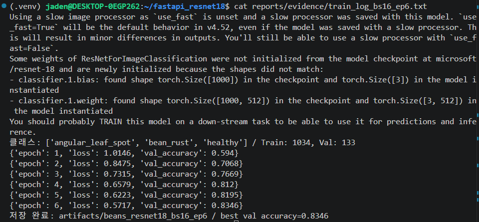
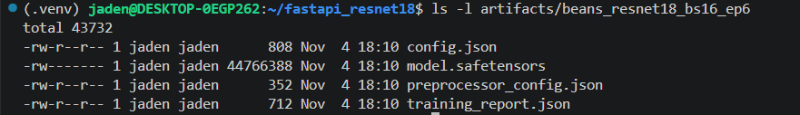
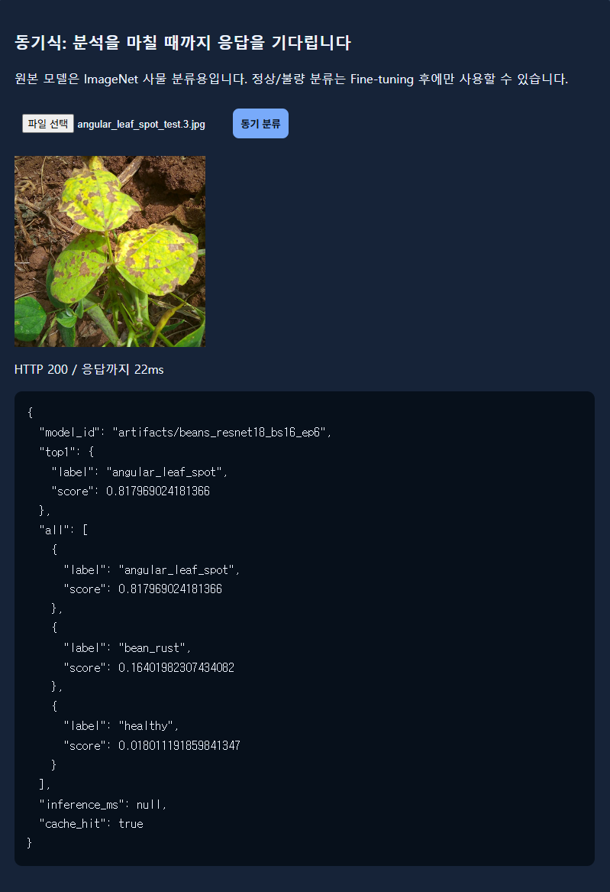

# ResNet18 콩잎 3클래스 Fine-tuning 결과보고서

- 평가 대상: 콩잎 질병 이미지 3종 분류 (angular_leaf_spot, bean_rust, healthy)
- 기준 모델: microsoft/resnet-18
- 학습 방식: Head-only (Backbone freeze)
- 입력 데이터: dataset/train, dataset/val
- 최종 보관 데이터: dataset/test (학습에 사용하지 않음. 사용 이력은 3.3 참고)
- 최종 모델: batch_size 16, epochs 6
- 모델 저장 위치: artifacts/beans_resnet18_bs16_ep6/
- 실험 상태: 실행 완료 (최종 모델 저장 2026-11-04 18:10, Test 평가 18:17)

## 1. 데이터 구성

| 클래스 | Train | Validation | Test | 합계 |
|---|---:|---:|---:|---:|
| angular_leaf_spot | 345 | 44 | 43 | 432 |
| bean_rust | 348 | 45 | 43 | 436 |
| healthy | 341 | 44 | 42 | 427 |
| 합계 | 1,034 | 133 | 128 | 1,295 |

- 원본 데이터: `dataset/train`, `dataset/val`, `dataset/test`
  - 제공된 구성을 그대로 사용했다.
- 원본 폴더: train / validation / test
- 코드 적용 폴더: train / val / test
  - 원본 validation은 val 이름으로 배치되어 있다 (파일명 예: `bean_rust_val.0.jpg`).
- 정답 클래스: 폴더 이름을 그대로 사용한다.
- 개수 기준: `.jpg` 파일 수
  - Train과 Validation 합계는 `training_report.json`의 `train_count: 1034`, `val_count: 133`과 같다.
- 이미지가 아닌 파일 1개
  - `dataset/train/healthy/healthy_train.120tore` (6,148 B)가 있다.
  - `file` 명령으로 확인한 형식은 macOS 폴더 메타데이터(Apple Desktop Services Store)이고, 이미지가 아니다.
  - 학습 코드가 이미지 확장자만 읽기 때문에 학습에서 빠졌다. 그래서 healthy Train은 파일 342개 중 이미지 341장이다.
- 데이터 누출 점검: 2026-11-04에 읽기 전용으로 실행했다.
  - 방법 1. `dataset/` 아래 `.jpg` 1,295개의 MD5 해시를 계산하고, 같은 해시가 두 개 이상의 분할(train/val/test)에 있는지 확인했다.
    - 결과: 분할 사이 중복 0건. 전체 중복 해시 0건.
  - 방법 2. 분할 사이에 같은 파일명이 있는지 확인했다 (train-val, train-test, val-test).
    - 결과: 모두 0건.
  - 한계: 바이트가 같은 파일만 찾는다. 크기나 압축만 다른 같은 사진은 찾지 못한다.
- 모든 실험은 같은 데이터 분할을 그대로 사용했다. 데이터를 다시 섞거나 나누지 않았다.

## 2. 실행 설정 (최종 모델)

| 파라미터 | 값 |
|---|---|
| base_model | microsoft/resnet-18 |
| epochs | 6 |
| batch_size | 16 |
| learning_rate | 0.0002 (제공 코드 기본값, `--lr` 미지정) |
| freeze_backbone | True (`classifier.*` 파라미터만 학습) |
| optimizer | AdamW (제공 코드) |
| output | artifacts/beans_resnet18_bs16_ep6 |
| seed | 42 (제공 코드: `random.seed(42)`, `torch.manual_seed(42)`) |
| 모델 저장 조건 | Validation Accuracy가 이전 최고값보다 클 때만 저장 (제공 코드: `acc > best_acc`) |

실행 명령 (제공 코드는 변경하지 않고 실행 옵션만 사용)

```bash
python -m training.finetune --data dataset --output artifacts/beans_resnet18_bs16_ep6 --epochs 6 --batch-size 16 --freeze-backbone 2>&1 | tee reports/evidence/train_log_bs16_ep6.txt
```

- 학습은 매번 원본 `microsoft/resnet-18`에서 시작한다. 이전 실험 모델을 이어서 학습하지 않는다.

실행 환경

| 항목 | 값 |
|---|---|
| OS | Ubuntu 26.04.1 LTS (WSL2) |
| Python | 3.14.4 (.venv) |
| torch | 2.15.0+cu132 (CUDA 사용 가능) |
| transformers | 4.57.6 |

## 3. 학습 결과

### 3.0 하이퍼파라미터 비교 (Validation 기준)

모두 Head-only, learning_rate 0.0002, seed 42, 같은 데이터이다. 서로 다른 output 폴더에 저장했다.

| 실험 | batch_size | epochs | output | Best Val Acc | 결정 |
|---|---:|---:|---|---:|---|
| A. 기존 기준선 | 8 | 3 | `artifacts/beans_resnet18` | 0.7669 (102/133) | 미채택 |
| B. batch 변경 | 16 | 3 | `artifacts/beans_resnet18_bs16` | 0.7669 (102/133) | 미채택 (개선 없음) |
| **C. batch 16 + epoch 증가** | **16** | **6** | **`artifacts/beans_resnet18_bs16_ep6`** | **0.8346 (111/133)** | **최종 채택** |

| Epoch | A Loss / Val Acc | B Loss / Val Acc | C Loss / Val Acc |
|---|---|---|---|
| 1 | 0.9924 / 0.6617 | 1.0146 / 0.5940 | 1.0146 / 0.5940 |
| 2 | 0.8108 / 0.7669 | 0.8475 / 0.7068 | 0.8475 / 0.7068 |
| 3 | 0.7078 / 0.7669 | 0.7315 / 0.7669 | 0.7315 / 0.7669 |
| 4 | — | — | 0.6579 / 0.8120 |
| 5 | — | — | 0.6223 / 0.8195 |
| 6 | — | — | 0.5717 / 0.8346 |

- 최종 모델은 **Validation Accuracy가 가장 높은 C**로 정했다.
- B와 C는 1~3 epoch 값이 같다. seed와 설정이 같기 때문이다.
- batch 16은 epoch당 가중치 업데이트 횟수가 batch 8의 절반이다 (약 130회 → 65회). 그래서 3 epoch에서는 batch 8보다 Loss가 높았다. 6 epoch까지 학습하자 Val이 계속 올랐다.
- C는 epoch 6에서도 Val이 오르는 중이었다. 더 학습하면 달라질 수 있지만, 이번 제출은 C로 확정했다.
- 근거
  - A: `artifacts/beans_resnet18/training_report.json`, [train_log.png](evidence/train_log.png)
  - B: `artifacts/beans_resnet18_bs16/training_report.json`, `evidence/train_log_bs16.txt`
  - C: `artifacts/beans_resnet18_bs16_ep6/training_report.json`, `evidence/train_log_bs16_ep6.txt`

### 3.1 최종 모델 학습 기록

| Epoch | Train Loss | Validation Accuracy | 모델 저장 |
|---|---:|---:|---|
| 1 | 1.0146 | 0.5940 | 저장 |
| 2 | 0.8475 | 0.7068 | 저장 |
| 3 | 0.7315 | 0.7669 | 저장 |
| 4 | 0.6579 | 0.8120 | 저장 |
| 5 | 0.6223 | 0.8195 | 저장 |
| 6 | 0.5717 | 0.8346 | 저장 (최종) |

- Best Validation Accuracy: 0.8346 (`training_report.json`: 0.8345864661654135 = 111/133)
- Best 모델 저장: artifacts/beans_resnet18_bs16_ep6/ (Epoch 6 가중치)
- 매 epoch Val이 이전 최고보다 높아서 매번 저장됐다. 최종 파일은 epoch 6 모델이다.

- 학습 로그 원문: `reports/evidence/train_log_bs16_ep6.txt` (`tee`로 저장, 실행 명령과 epoch 1~6 출력 포함)
- 학습 로그 캡처 (로그 파일 `cat` 화면): [train_log_bs16_ep6.png](evidence/train_log_bs16_ep6.png)
  - 실행 명령은 2장과 같다 (`--output artifacts/beans_resnet18_bs16_ep6 --epochs 6 --batch-size 16 --freeze-backbone`).



### 3.2 Test 평가 (별도 추가 스크립트)

제공 코드 `training/finetune.py`에는 Test 평가 절차가 없다. 그래서 `training/evaluate_test.py`를 따로 추가했다.

```bash
python -m training.evaluate_test --model artifacts/beans_resnet18_bs16_ep6
```

- 평가 시각: 2026-11-04 18:17:03 (1회, 소요 1.8초)
- Test Accuracy: **0.8750 (112/128)**
- Macro F1: **0.8752**

| 클래스 | Support | Precision | Recall | F1 |
|---|---:|---:|---:|---:|
| angular_leaf_spot | 43 | 0.8163 | 0.9302 | 0.8696 |
| bean_rust | 43 | 0.8718 | 0.7907 | 0.8293 |
| healthy | 42 | 0.9500 | 0.9048 | 0.9268 |

혼동행렬 (행: 정답, 열: 예측)

| 정답 \ 예측 | angular_leaf_spot | bean_rust | healthy |
|---|---:|---:|---:|
| angular_leaf_spot | 40 | 2 | 1 |
| bean_rust | 8 | 34 | 1 |
| healthy | 1 | 3 | 38 |

- 오분류: 16장
- 가장 많은 오분류: bean_rust를 angular_leaf_spot으로 예측한 경우 (8건)
- Recall이 가장 낮은 클래스: bean_rust (0.7907)
- Test Accuracy(0.8750)는 Validation Accuracy(0.8346)보다 4.04%p 높다.
- 근거 파일
  - `reports/data/test_metrics_beans_resnet18_bs16_ep6.json`
  - `reports/data/test_predictions_beans_resnet18_bs16_ep6.csv`
  - `reports/evidence/test_eval_log_beans_resnet18_bs16_ep6.txt`
  - `reports/figures/test_confusion_beans_resnet18_bs16_ep6.png`
  - `reports/figures/test_misclassified_beans_resnet18_bs16_ep6.png`

### 3.3 Test 사용 이력 (공개)

| 시각 | 모델 | Test Accuracy | Macro F1 | 근거 |
|---|---|---:|---:|---|
| 16:42:48 | A. batch 8, epoch 3 (15:48 저장본) | 0.7188 (92/128) | 0.7109 | `reports/data/test_metrics_beans_resnet18.json` |
| 18:17:03 | C. batch 16, epoch 6 (최종) | 0.8750 (112/128) | 0.8752 | `reports/data/test_metrics_beans_resnet18_bs16_ep6.json` |

- 같은 dataset/test를 두 모델에 각각 1회씩, 모두 2회 사용했다.
- 최종 모델 C는 Validation 기준으로 선택했다. B는 Test를 실행하지 않았다.
- 다만 A의 Test 결과를 본 뒤 추가 실험(B, C)을 진행했다. 그래서 C의 Test 점수에는 낙관 편향이 있을 수 있다.
- 학습 중에는 어떤 모델도 test 이미지를 읽지 않았다. 학습에는 train, 저장 시점 선택에는 val만 쓴다.
- A 모델의 Test 이후 기록
  - 17:02에 같은 batch 8 명령으로 모델이 다시 저장됐다 (Val 수치 같음).
  - Test 재사용을 피하려고 그 모델은 다시 평가하지 않았다.
- A의 클래스별 결과 (참고)
  - bean_rust Recall 0.5349
  - bean_rust → angular_leaf_spot 13건

### 3.4 선택 실험: Full Fine-tuning (로그 기준 참고값)

실행 경위
1. 처음에 실수로 옵션 없이 `python training/finetune.py`를 실행했다.
   - 이때 적용된 값은 모두 제공 코드 기본값이다 (epochs 3, batch_size 8, learning_rate 0.0002, output artifacts/beans_resnet18).
   - `--freeze-backbone`이 없어서 Full Fine-tuning으로 학습됐다.
2. 그다음 Head-only(A) 명령을 같은 `artifacts/beans_resnet18`에 실행해 Full 결과를 대체했다.
3. 그 뒤 `--output artifacts/beans_resnet18_full`로 Full 학습을 한 번 더 실행했다 (셸 기록).
   - 출력은 기록하지 않았다.
   - 폴더는 제출 대상이 아니라서 의도적으로 삭제했다.

| Epoch | Full Loss | Full Val Acc |
|---|---:|---:|
| 1 | 0.4077 | 0.9474 |
| 2 | 0.2186 | 0.9323 |
| 3 | 0.1148 | 0.9549 |

- 위 수치는 1번 실행의 터미널 로그를 옮긴 참고값이다. 모델 파일과 training_report.json은 남아 있지 않다.
- Full의 Val 최고(0.9549)는 최종 Head-only 모델 C(0.8346)보다 12.03%p 높다.
- Full 모델의 Test Accuracy: 미측정

## 4. 생성 파일 확인

`artifacts/beans_resnet18_bs16_ep6/` (2026-11-04 18:10)

- [x] config.json (808 B, `id2label`: 0 angular_leaf_spot / 1 bean_rust / 2 healthy)
- [x] model.safetensors (44,766,388 B, SHA-256 `fce87a914588e3b62d825c1f4d38968ce845352d20d7c695f9b361a344a4d7ba`)
- [x] preprocessor_config.json (352 B, shortest_edge 224, ImageNet mean/std)
- [x] training_report.json (712 B, 이 보고서 3.1 수치와 같음)



비교 실험 폴더 (삭제하지 않고 보관)

| 폴더 | 실험 | model.safetensors SHA-256 앞 16자 |
|---|---|---|
| `artifacts/beans_resnet18` | A (17:02 저장본) | c4ba88e15fa7a0a3 |
| `artifacts/beans_resnet18_bs16` | B | 0712270b8726bb82 |

- 비교 실험 A, B의 모델 폴더 캡처는 제출 증빙에서 제외했다. 두 폴더와 `training_report.json`은 그대로 보관한다.

## 5. 서비스 연결 확인

- MODEL_PATH: `artifacts/beans_resnet18_bs16_ep6` (`.env`, 18:23 변경. Celery Worker 18:31:35, Uvicorn 18:31:40 재시작)
  - `ai/config.py`는 `.env`에 값이 없으면 기본값 `microsoft/resnet-18`을 쓴다.
- 모델 로드: `ai/hf_model.py`에서 `pipeline("image-classification", model=MODEL_PATH, device=-1)`로 불러온다 (CPU 추론, 프로세스별 첫 요청에서 1회 로드).
- 동기 API: `POST /api/sync/classify/` (multipart 필드 `image`)
- 확인 일시: 2026-11-04 18:31
- 사용한 이미지: 클래스별 `dataset/test/<클래스>/` 첫 파일 (`*_test.0.jpg`)

| 사용 이미지 (정답 폴더) | 응답 라벨 (top1) | 응답 점수 | model_id | inference_ms | 정답 일치 |
|---|---|---:|---|---:|---|
| angular_leaf_spot/angular_leaf_spot_test.0.jpg | angular_leaf_spot | 0.5801 | artifacts/beans_resnet18_bs16_ep6 | 16.02 | 일치 |
| bean_rust/bean_rust_test.0.jpg | bean_rust | 0.7914 | artifacts/beans_resnet18_bs16_ep6 | 16.79 | 일치 |
| healthy/healthy_test.0.jpg | healthy | 0.5704 | artifacts/beans_resnet18_bs16_ep6 | 16.66 | 일치 |

- 세 요청 모두 HTTP 200, `cache_hit: false`이다. 응답의 `model_id`로 서비스가 최종 모델을 쓰고 있음을 확인했다.
- 원본 응답: `reports/evidence/raw_bs16_ep6/T02_sync_*.txt`
- 화면 확인 (18:36): [sync_page_bs16_ep6.png](evidence/sync_page_bs16_ep6.png). `angular_leaf_spot_test.3.jpg` → angular_leaf_spot 0.8180, `model_id` = bs16_ep6, 정답. 18:32 성능 측정 때 같은 이미지를 보냈기 때문에 600초 안이라 `cache_hit: true`, `inference_ms: null`로 나왔다.



참고: 교체 전 A 모델(batch 8)로 확인한 결과 (2026-11-04 17:13)

| 사용 이미지 (정답 폴더) | 응답 라벨 (top1) | 응답 점수 | model_id | 정답 일치 |
|---|---|---:|---|---|
| angular_leaf_spot/angular_leaf_spot_test.0.jpg | angular_leaf_spot | 0.4623 | artifacts/beans_resnet18 | 일치 |
| bean_rust/bean_rust_test.0.jpg | bean_rust | 0.6051 | artifacts/beans_resnet18 | 일치 |
| healthy/healthy_test.0.jpg | healthy | 0.6369 | artifacts/beans_resnet18 | 일치 |

- 원본 응답: `reports/evidence/raw/T02_sync_*.txt`, [sync_page.png](evidence/sync_page.png)

## 6. 결과 판정

- 완료
  - Head-only Fine-tuning 하이퍼파라미터 3가지를 비교했다.
  - Validation 기준으로 최종 모델(batch 16, epoch 6, Best Val 0.8346)을 선택하고 모델 파일 4개를 생성했다.
  - 별도 스크립트로 최종 모델의 Test를 1회 평가했다 (Accuracy 0.8750, Macro F1 0.8752).
  - MD5 기준으로 분할 사이 중복 이미지가 없음을 확인했다.
- 한계
  - Test 사용 이력: 같은 Test를 기준선 A 평가에 먼저 1회 사용했다. 최종 모델 C의 Test 점수는 낙관 편향이 있을 수 있다 (3.3).
  - 최종 모델은 epoch 6에서도 Val이 오르는 중이었다. 최적 epoch는 확인하지 않았다.
  - bean_rust Recall이 0.7907로 가장 낮고, angular_leaf_spot으로 잘못 예측한 경우가 8건이다.
  - Full Fine-tuning은 로그 기준 Val 0.9549였지만, 산출물이 남지 않아 Test 비교를 하지 못했다.
  - 누출 점검은 바이트가 같은 파일만 찾는다.
  - Test 평가는 제공 코드가 아니라 추가 스크립트로 했다.
- 증빙
  - 학습 로그: `evidence/train_log_bs16_ep6.txt`, [evidence/train_log_bs16_ep6.png](evidence/train_log_bs16_ep6.png)
  - 모델 폴더: [evidence/model_folder_bs16_ep6.png](evidence/model_folder_bs16_ep6.png)
  - artifacts/beans_resnet18_bs16_ep6/training_report.json
  - reports/evidence/test_eval_log_beans_resnet18_bs16_ep6.txt
  - reports/figures/test_confusion_beans_resnet18_bs16_ep6.png
