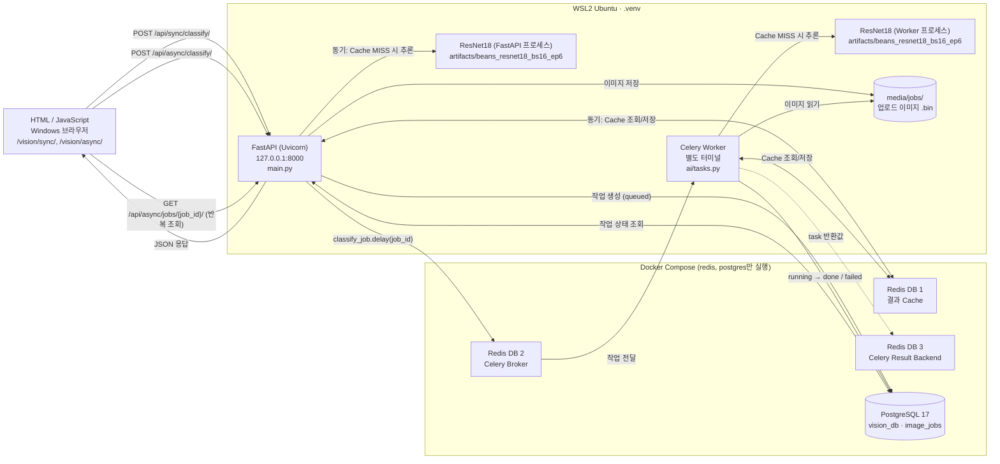
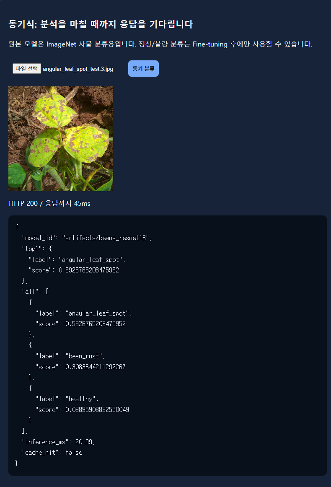
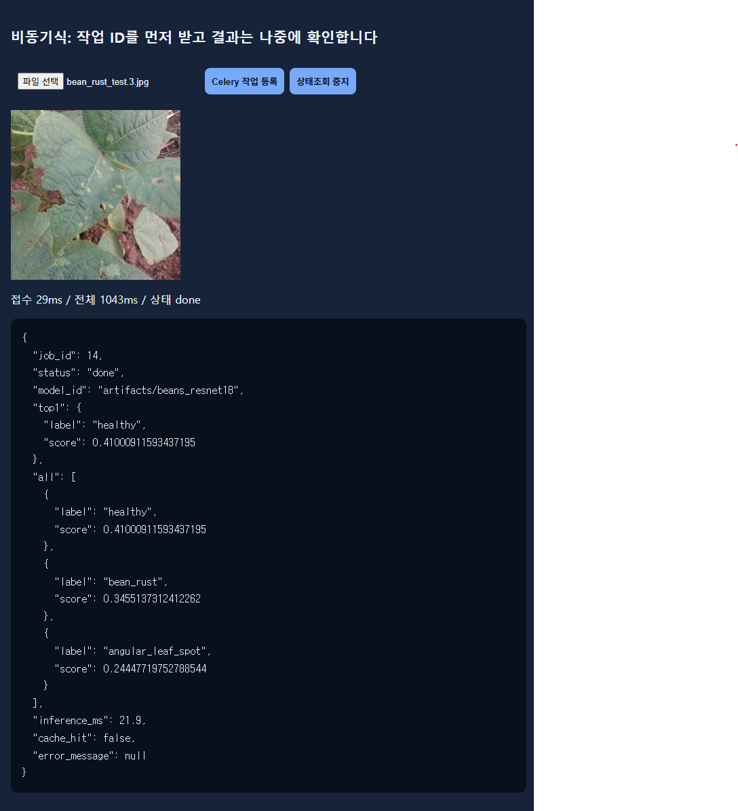

# 전체 시스템 아키텍처 설계서

- 대상 시스템: ResNet18 콩잎 3클래스 분류 서비스 (동기 API + 비동기 작업 큐)
- 모델: `artifacts/beans_resnet18_bs16_ep6` (산출물 1의 최종 Head-only 모델, batch 16, epoch 6). 2026-11-04 18:31에 서비스 모델을 교체했다.
- 실행 원칙
  - Docker Compose로는 Redis와 PostgreSQL만 실행한다.
  - FastAPI와 Celery Worker는 WSL2의 `.venv`에서 실행한다.
- 근거 파일: `main.py`, `ai/*.py`, `templates/*.html`, `compose.yaml`, `.env`

## 1. 구성도

- ResNet18 모델은 FastAPI 프로세스와 Celery Worker 프로세스에서 **각각 따로** 로드된다.
  - 로드는 `ai/hf_model.py`의 `@lru_cache(maxsize=1)`로 프로세스별 첫 요청 때 1회 일어난다.
- Redis는 컨테이너 1개이지만 DB 번호로 역할을 나눈다.
  - DB 1: 결과 Cache
  - DB 2: Celery Broker
  - DB 3: Celery Result Backend
- 상태 조회 API(`/api/async/jobs/{job_id}/`)는 PostgreSQL만 읽는다. Redis DB 3을 읽지 않는다.

## 2. 컴포넌트 역할표

| 컴포넌트 | 실행 위치 | 사용 파일 / 서비스 | 역할 |
|---|---|---|---|
| 브라우저 | Windows 웹브라우저 | `templates/sync.html`, `templates/async.html`, `templates/base.html`, `static/style.css` | 이미지 업로드, 결과 표시. 비동기 화면은 `check_url`을 반복 조회 |
| FastAPI | WSL2 `.venv` (Uvicorn, 127.0.0.1:8000) | `main.py`, `ai/router_web.py`, `ai/router_sync.py`, `ai/router_async.py` | 화면 제공, 업로드 검증(5MB, JPG/PNG/WEBP, 1200만 픽셀), 동기 추론, 비동기 작업 등록, 상태 조회. 시작 시 `init_db()`로 테이블 생성 |
| ResNet18 추론 | WSL2, FastAPI와 Worker 각 프로세스 | `ai/hf_model.py`, `ai/services.py`, `artifacts/beans_resnet18_bs16_ep6/` | `pipeline("image-classification", device=-1)`로 CPU 추론. top_k=5 결과 반환 |
| Redis Cache | Docker `redis` · DB 1 | `ai/cache_service.py` | 같은 이미지·같은 모델의 결과를 600초 동안 재사용. 키: `vision:classify:{모델경로 해시16}:{이미지 SHA-256}`. Redis 장애 시 바로 추론 |
| Redis Broker | Docker `redis` · DB 2 | `ai/celery_app.py` | Celery 작업(`ai.classify_job`) 전달 |
| Redis Result Backend | Docker `redis` · DB 3 | `ai/celery_app.py` | Celery task 반환값 저장. API는 이 값을 읽지 않음 |
| PostgreSQL | Docker `postgres` | `ai/database.py`, `ai/models.py` (`image_jobs` 테이블) | 비동기 작업의 상태(queued/running/done/failed)와 결과 저장 |
| Celery Worker | WSL2 `.venv`, 별도 터미널 | `ai/celery_app.py`, `ai/tasks.py` | DB에서 작업 조회 → `media/jobs/` 이미지 읽기 → Cache/추론 → DB 갱신 |
| 업로드 이미지 저장소 | WSL2 파일시스템 | `media/jobs/{uuid}.bin` | 비동기 요청 이미지 보관. 사용자 파일명은 쓰지 않음 |

## 3. 실행환경

| 항목 | 값 | 확인 방법 |
|---|---|---|
| 운영체제 | Windows 11 Pro (10.0.26200.9711) + WSL2 Ubuntu 26.04.1 LTS | `ver`, `/etc/os-release` |
| WSL 커널 | 6.18.54.1-microsoft-standard-WSL2 | `uname -r` |
| Python | 3.14.4 (`.venv`) | `.venv/bin/python -V` |
| 주요 패키지 | fastapi 0.162.0, uvicorn 0.54.0, celery 5.6.3, redis 6.4.0, SQLAlchemy 2.1.8, psycopg 3.3.7, transformers 4.57.6, torch 2.15.0+cu132, pillow 12.3.0 | `pip list` |
| Docker | Docker 29.9.2, Docker Compose v5.6.1 | `docker --version`, `docker compose version` |
| Docker 서비스 | `redis:7.4-alpine` (127.0.0.1:6379, appendonly yes), `postgres:17-alpine` (127.0.0.1:5432, DB `vision_db`) | `docker compose ps` |
| 서버 프로세스 | FastAPI Uvicorn: `uvicorn main:app --host 127.0.0.1 --port 8000` | 실행 중 프로세스 확인 (`ps`). 17:12 시작, 모델 교체 후 18:31:40 재시작 |
| 워커 프로세스 | Celery: `celery -A ai.celery_app:celery_app worker --loglevel=info --pool=solo --concurrency=1` | 실행 중 프로세스 확인 (`ps`). 17:11 시작, 모델 교체 후 18:31:35 재시작. `compose.yaml` worker 명령과 같은 옵션 |
| 모델 경로 | `MODEL_PATH=artifacts/beans_resnet18_bs16_ep6` (17:13 측정 때는 `artifacts/beans_resnet18`) | `.env` |
| 연결 주소 (.venv 기본값) | DB `postgresql+psycopg://…@127.0.0.1:5432/vision_db`, Cache `redis://127.0.0.1:6379/1`, Broker `…/2`, Result `…/3` | `ai/config.py` |
| 하드웨어 | NVIDIA GeForce RTX 3060 (학습에 사용 가능) | `nvidia-smi` |
| 서비스 추론 장치 | CPU (`device=-1`) | `ai/hf_model.py` |

- `.env`에는 `MODEL_PATH`만 있다. DB와 Redis 주소는 `ai/config.py` 기본값(127.0.0.1)을 쓴다.

### compose.yaml에 정의됐지만 이번 실행에 쓰지 않은 서비스

| 서비스 | 정의 내용 | 현재 상태 |
|---|---|---|
| `web` | FastAPI 컨테이너 (Python 3.11, CPU torch, 127.0.0.1:8000) | `Exited (0)`, 사용 안 함 |
| `worker` | Celery 컨테이너 (`--pool=solo --concurrency=1`) | `Exited (0)`, 사용 안 함 |
| `trainer` | 학습 컨테이너 (`profiles: ["train"]`) | 생성 안 됨 |

- 셸 기록에는 `docker compose up -d --build`가 남아 있다. 그래서 web과 worker 컨테이너는 한 번 만들어졌다가 지금은 멈춰 있다.
- 이번 평가 구성에서 FastAPI와 Worker는 `.venv`에서 실행한다.
- web 컨테이너가 다시 시작되면 8000번 포트가 겹친다. 그래서 `docker compose up -d`는 서비스 이름을 지정해서 실행한다: `docker compose up -d redis postgres`

## 4. 구조 검증 결과

| 흐름 | 경로 | 근거 코드 |
|---|---|---|
| 동기 (Cache MISS) | 브라우저 → FastAPI `POST /api/sync/classify/` → Redis DB 1 조회(없음) → ResNet18 추론 (FastAPI 프로세스) → Redis DB 1 저장(600초) → JSON 응답 (`cache_hit: false`) | `router_sync.py`, `cache_service.py`, `services.py` |
| 동기 (Cache HIT) | 브라우저 → FastAPI → Redis DB 1 조회(있음) → JSON 응답 (`cache_hit: true`, `inference_ms: null`) | `cache_service.py` |
| 비동기 등록 | 브라우저 → FastAPI `POST /api/async/classify/` → 이미지 검증 → `media/jobs/{uuid}.bin` 저장 → PostgreSQL `image_jobs` (queued) → Redis DB 2 → 202 응답 (`job_id`, `check_url`) | `router_async.py` |
| 비동기 처리 | Celery Worker → `image_jobs` (running) → 이미지 읽기 → Redis DB 1 조회 / ResNet18 추론 (Worker 프로세스) → `image_jobs` (done 또는 failed) | `tasks.py` |
| 비동기 조회 | 브라우저 → FastAPI `GET /api/async/jobs/{job_id}/` → PostgreSQL 조회 → JSON 응답 | `router_async.py`, `async.html` |

- 동기 호출 결과는 `image_jobs`에 저장하지 않는다. 동기 경로에는 DB 쓰기 코드가 없다.
- 동기 결과와 비동기 결과는 같은 Redis Cache 키를 쓴다. 그래서 같은 이미지를 동기로 먼저 보낸 뒤 600초 안에 비동기로 보내면, Worker가 추론하지 않고 `cache_hit: true`로 처리할 수 있다.
- Redis 연결이 안 되는 경우
  - 동기: Cache를 건너뛰고 추론한다.
  - 비동기 등록: 큐 등록에 실패하면 작업이 `failed`로 기록되고 503을 반환한다.
### 실행 확인 1: 기준선 A 모델로 서비스할 때 (2026-11-04 17:12~17:13)

| 확인 항목 | 결과 | 근거 |
|---|---|---|
| 프로세스 기동 | Celery Worker 연결(`ai.classify_job` 등록), Uvicorn 127.0.0.1:8000 | [worker_start.png](evidence/worker_start.png), [uvicorn_start.png](evidence/uvicorn_start.png) |
| Docker 서비스 | Redis `PONG`, PostgreSQL `accepting connections`. 실행 컨테이너는 redis, postgres 2개 | `evidence/raw/T05_infra.txt` |
| 동기 MISS | 200, `cache_hit: false`, 추론 약 17ms | `evidence/raw/T02_sync_*.txt` |
| 동기 HIT | 같은 이미지 재요청 시 200, `cache_hit: true`, `inference_ms: null` | `evidence/raw/T09_cache_*.txt` |
| 비동기 | 202 + `job_id` 3 → `running` → `done` | `evidence/raw/T03_async_post.txt`, `T04_async_poll.txt` |
| Worker 처리 로그 | `Task ai.classify_job[...] received` → `succeeded`. job 3은 2.29초 (모델 첫 로드 포함), job 4~6은 약 0.03초. `Device set to use cpu` | [worker_log.png](evidence/worker_log.png) |
| FastAPI 접근 로그 | 200, 202, 400, 404, 413 응답 기록 | [uvicorn_log.png](evidence/uvicorn_log.png) |
| 동기 결과 DB 미저장 | 테스트 후 `image_jobs`에는 비동기 요청 행만 있음 (동기 요청은 행이 생기지 않음) | `evidence/raw/T06_db_image_jobs.txt` |
| 모델 별도 로드 | 첫 요청 추론 시간: FastAPI 2253.55ms, Worker 2215.86ms. 프로세스마다 모델을 따로 불러와서 첫 요청이 각각 느리다 | `evidence/raw/W01_warmup_sync.txt`, `T04_async_final.txt` |

### 실행 확인 2: 최종 모델로 교체한 뒤 (2026-11-04 18:31~18:32)

교체 절차: `.env`의 `MODEL_PATH`를 `artifacts/beans_resnet18_bs16_ep6`로 변경(18:23) → Celery Worker(18:31:35)와 Uvicorn(18:31:40) 재시작

| 확인 항목 | 결과 | 근거 |
|---|---|---|
| 모델 반영 | 모든 응답의 `model_id`가 `artifacts/beans_resnet18_bs16_ep6` | `evidence/raw_bs16_ep6/W01_warmup_sync.txt`, `T02_sync_*.txt` |
| Docker 서비스 | Redis `PONG`, PostgreSQL `accepting connections` | `evidence/raw_bs16_ep6/T05_infra.txt` |
| 동기 MISS / HIT | 200, 추론 약 16ms / 같은 이미지 재요청 시 `cache_hit: true` | `evidence/raw_bs16_ep6/T02_*`, `T09_*` |
| 비동기 | 202 + `job_id` 16 → `running` → `done` | `evidence/raw_bs16_ep6/T03_async_post.txt`, `T04_async_poll.txt` |
| 동기 결과 DB 미저장 | 교체 후 생긴 행은 id 16~26, 11개. 비동기 요청 수(11)와 같음 | `evidence/raw_bs16_ep6/T06_db_image_jobs.txt` |
| 모델 별도 로드 | 첫 요청 추론 시간: FastAPI 2125.23ms, Worker 2255.94ms | `evidence/raw_bs16_ep6/W01_warmup_sync.txt`, `T04_async_final.txt` |
| 화면 캡처 | [sync_page_bs16_ep6.png](evidence/sync_page_bs16_ep6.png), [async_page_bs16_ep6.png](evidence/async_page_bs16_ep6.png), [db_rows_bs16_ep6.png](evidence/db_rows_bs16_ep6.png) | 18:36~18:40 |

- 최종 모델 실행 중 Worker·Uvicorn 로그 캡처는 따로 찍지 않았다. 같은 코드의 로그 예시로 기준선 A 실행 때의 [worker_log.png](evidence/worker_log.png), [uvicorn_log.png](evidence/uvicorn_log.png)를 참고한다. 최종 모델의 동작 근거는 `evidence/raw_bs16_ep6/`의 상태코드·`model_id` 원본 응답과 DB 시각(`T06_db_image_jobs.txt`), [db_rows_bs16_ep6.png](evidence/db_rows_bs16_ep6.png)이다.

- 모델을 바꿔도 구조(파일, 프로세스, Redis DB 번호, 테이블)는 그대로이다. `.env`의 `MODEL_PATH`와 두 프로세스 재시작만 필요했다.
- 캐시 키에 `MODEL_PATH` 해시가 들어간다. 그래서 교체 전 모델의 캐시 결과는 새 모델 요청에 쓰이지 않는다 (교체 후 첫 요청이 모두 MISS).
