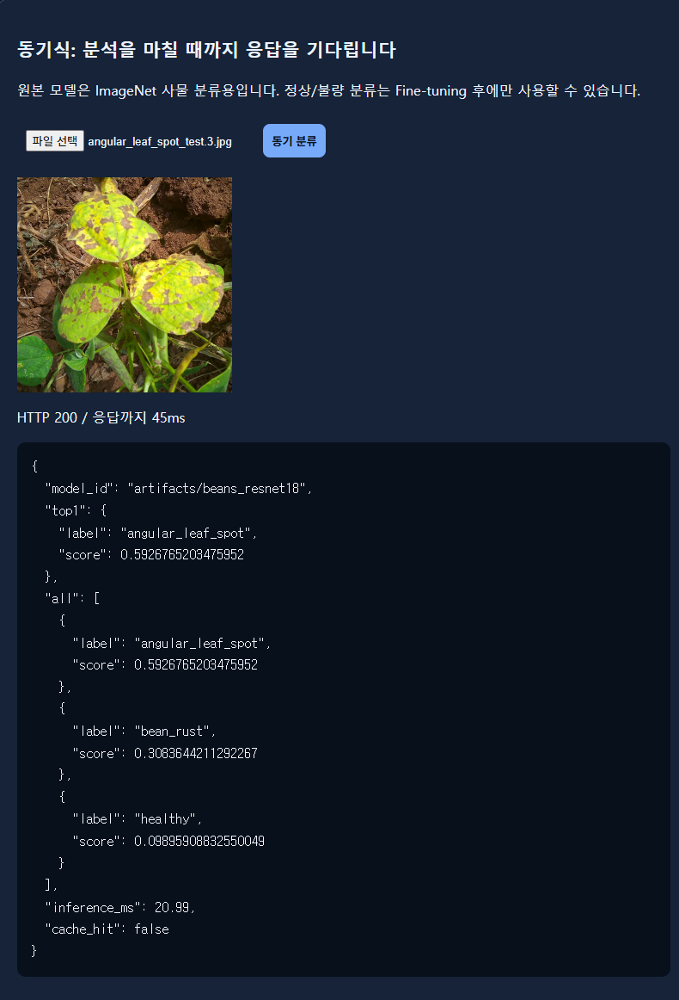
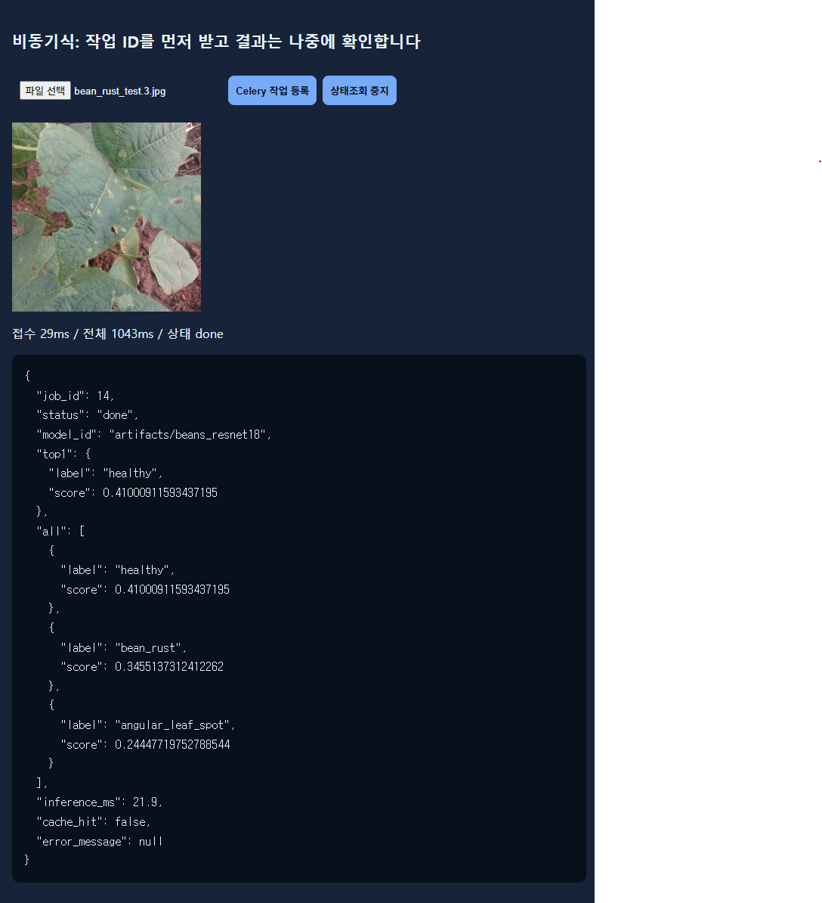
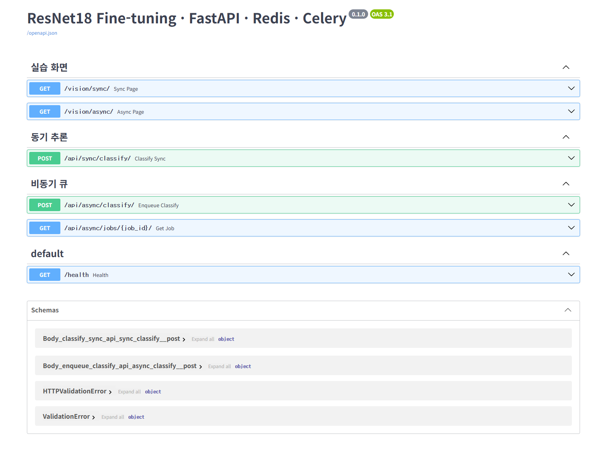

# API 명세서

- 대상 서버: FastAPI (`main.py`), `http://127.0.0.1:8000`
- 근거
  - 코드: `main.py`, `ai/router_web.py`, `ai/router_sync.py`, `ai/router_async.py`, `ai/services.py`, `ai/cache_service.py`
  - 실제 호출 결과: `reports/evidence/raw/` (2026-11-04 17:12~17:30, curl)
- 아래 JSON은 모두 실제 응답을 그대로 옮긴 것이다. 긴 소수는 원본 그대로 두었다.
- 1~5장의 예시는 기준선 A 모델(`artifacts/beans_resnet18`)로 서비스할 때(17:12~17:30) 받은 응답이다. 최종 모델(`artifacts/beans_resnet18_bs16_ep6`)로 교체한 뒤의 응답과 재검증 결과는 6장에 있다.
- API 형식(URL, 필드, 상태코드)은 모델과 관계없이 같다. 바뀌는 것은 `model_id`와 점수 값뿐이다.

## 1. API 목록

| API ID | Method | URL | 요청 형태 | 성공 HTTP | 주요 응답 | 실패 HTTP |
|---|---|---|---|---:|---|---|
| API-01 | GET | `/health` | 없음 | 200 | `status` | 서버 미실행은 HTTP 응답 없음 (연결 실패) |
| API-02 | POST | `/api/sync/classify/` | `multipart/form-data` / `image` | 200 | `model_id`, `top1`, `all`, `inference_ms`, `cache_hit` | 400, 413, 422 |
| API-03 | POST | `/api/async/classify/` | `multipart/form-data` / `image` | 202 | `job_id`, `status`, `check_url` | 400, 413, 422, 503 |
| API-04 | GET | `/api/async/jobs/{job_id}/` | 경로의 정수 `job_id` | 200 | `job_id`, `status`, `model_id`, `top1`, `all`, `inference_ms`, `cache_hit`, `error_message` | 404, 422 |
| WEB-01 | GET | `/vision/sync/` | 없음 | 200 | HTML (`templates/sync.html`) | — |
| WEB-02 | GET | `/vision/async/` | 없음 | 200 | HTML (`templates/async.html`) | — |
| WEB-00 | GET | `/` | 없음 | 307 | `location: /vision/sync/`로 이동 | — |

- 422는 FastAPI가 자동으로 만든다. `image` 필드가 없거나 `job_id`가 정수가 아닐 때 나온다.
- 400, 404, 413, 503은 코드에서 `HTTPException`으로 직접 만든다. 응답 형식은 `{"detail": "메시지"}`이다.

## 2. 공통 입력 검증 (API-02, API-03)

| 순서 | 검증 | 실패 시 | 코드 위치 |
|---|---|---|---|
| 1 | `image` 필드 존재 | 422 | FastAPI `File(...)` |
| 2 | 파일 크기 5MB 이하 (`MAX_UPLOAD_BYTES = 5 * 1024 * 1024`). 최대 5MB+1바이트만 읽고 판단 | 413 `5MB 이하 파일만 허용합니다.` | `router_sync.py`, `router_async.py` |
| 3 | 1바이트 이상 | 400 `이미지 파일은 1바이트 이상, 5MB 이하이어야 합니다.` | `services.load_rgb_image` |
| 4 | 실제 이미지 형식이 JPEG / PNG / WEBP (파일 내용으로 판단, 확장자·Content-Type은 보지 않음) | 400 `JPG, PNG, WEBP 이미지만 허용합니다.` 또는 `올바른 이미지 파일이 아닙니다.` | `services.load_rgb_image` |
| 5 | 해상도 1200만 픽셀 이하 | 400 `이미지 해상도가 너무 큽니다(최대 1200만 픽셀).` | `services.load_rgb_image` |

## 3. API별 상세

### API-01: 서버 상태 확인

| 항목 | 내용 |
|---|---|
| URL | `/health` |
| Method | GET |
| 성공 코드 | 200 OK |
| 비고 | DB, Redis, 모델 상태는 확인하지 않는다. 프로세스가 응답하는지만 확인한다 |

```json
{"status":"ok"}
```
증빙: `evidence/raw/T01_health.txt`

### API-02: 동기 분류

| 항목 | 내용 |
|---|---|
| URL | `/api/sync/classify/` |
| Method | POST |
| Content-Type | `multipart/form-data` |
| 요청 필드 | `image`: JPEG/PNG/WEBP, 5MB 이하, 1200만 픽셀 이하 |
| 성공 코드 | 200 OK (추론이 끝난 뒤 응답) |
| 오류 코드 | 400 잘못된 이미지, 413 크기 초과, 422 `image` 누락 |
| 캐시 | Redis DB 1, 키 `vision:classify:{MODEL_PATH 해시 16자}:{이미지 SHA-256}`, 600초 |
| DB 저장 | 하지 않음 (`image_jobs`에 행이 생기지 않음) |

응답 필드

| 필드 | 형식 | 설명 |
|---|---|---|
| `model_id` | 문자열 | 사용한 모델 경로 (`MODEL_PATH`) |
| `top1` | 객체 `{label, score}` | 점수가 가장 높은 클래스 |
| `all` | 배열 `[{label, score}]` | 점수 내림차순. `top_k=5`로 요청하지만 클래스가 3개라 3개가 나온다 |
| `inference_ms` | 숫자 또는 null | 모델 추론 시간(ms). 캐시 HIT이면 null |
| `cache_hit` | 불리언 | Redis 캐시 결과를 쓴 경우 true |

성공 응답, 캐시 MISS (`dataset/test/bean_rust/bean_rust_test.0.jpg`)

```json
{"model_id":"artifacts/beans_resnet18","top1":{"label":"bean_rust","score":0.6051397323608398},"all":[{"label":"bean_rust","score":0.6051397323608398},{"label":"healthy","score":0.2607002258300781},{"label":"angular_leaf_spot","score":0.13415999710559845}],"inference_ms":17.57,"cache_hit":false}
```
증빙: `evidence/raw/T02_sync_bean_rust.txt`

성공 응답, 캐시 HIT (같은 이미지 재요청)

```json
{"model_id":"artifacts/beans_resnet18","top1":{"label":"bean_rust","score":0.6051397323608398},"all":[{"label":"bean_rust","score":0.6051397323608398},{"label":"healthy","score":0.2607002258300781},{"label":"angular_leaf_spot","score":0.13415999710559845}],"inference_ms":null,"cache_hit":true}
```
증빙: `evidence/raw/T09_cache_1st.txt`, `T09_cache_2nd.txt`

오류 응답

```json
{"detail":"올바른 이미지 파일이 아닙니다."}
```
(400, 텍스트 파일 업로드. 증빙: `evidence/raw/T07_invalid_txt.txt`)

```json
{"detail":"5MB 이하 파일만 허용합니다."}
```
(413, 6,000,000 B 파일. 증빙: `evidence/raw/T11_too_large_413.txt`)

```json
{"detail":[{"type":"missing","loc":["body","image"],"msg":"Field required","input":null}]}
```
(422, `image` 없이 요청. 증빙: `evidence/raw/T12_missing_image_422.txt`)

### API-03: 비동기 작업 등록

| 항목 | 내용 |
|---|---|
| URL | `/api/async/classify/` |
| Method | POST |
| Content-Type | `multipart/form-data` |
| 요청 필드 | `image`: API-02와 같은 조건 |
| 성공 코드 | 202 Accepted |
| 오류 코드 | 400 잘못된 이미지, 413 크기 초과, 422 `image` 누락, 503 큐 등록 실패 |
| 처리 순서 | 이미지 검증 → `media/jobs/{uuid}.bin` 저장 → `image_jobs` 행 생성(`queued`) → `classify_job.delay(job_id)` → 202 응답 |

- 202는 **접수**만 뜻한다. 분류가 끝났다는 뜻이 아니다. 완료 여부는 API-04에서 `status`가 `done`인지로 확인한다.
- 503: Redis Broker 연결에 실패하면 작업을 `failed`로 기록하고 `{"detail": "작업 큐 등록 실패: Redis 연결을 확인하세요."}`를 돌려준다. 이 경우는 코드로만 확인했고 실행하지 않았다. Redis를 멈춰야 재현할 수 있다.

성공 응답

```json
{"job_id":3,"status":"queued","check_url":"/api/async/jobs/3/"}
```
증빙: `evidence/raw/T03_async_post.txt` (입력 `dataset/test/bean_rust/bean_rust_test.1.jpg`)

오류 응답: 400 `evidence/raw/T07_invalid_txt_async.txt`, 413 `evidence/raw/T11b_too_large_413_async.txt` (본문은 API-02와 같다)

### API-04: 비동기 작업 조회

| 항목 | 내용 |
|---|---|
| URL | `/api/async/jobs/{job_id}/` |
| Method | GET |
| 경로 변수 | `job_id`: 정수 (API-03 응답의 `job_id`) |
| 성공 코드 | 200 OK (작업 상태와 관계없이 200) |
| 오류 코드 | 404 작업 없음, 422 `job_id`가 정수가 아님 |
| 조회 대상 | PostgreSQL `image_jobs` (Redis Result Backend는 읽지 않음) |

`status` 값

| 값 | 의미 | `top1`, `all` |
|---|---|---|
| `queued` | 등록됨, Worker 처리 전 | null |
| `running` | Worker 처리 중 | null |
| `done` | 완료 | 결과 있음 |
| `failed` | 실패 | null, `error_message`에 원인 |

- 응답 필드 `all`은 DB 컬럼 `all_scores`의 값이다. 응답 필드 `top1`은 DB 컬럼 `top1_label`, `top1_score`를 묶은 것이다.

실제 상태 변화 (job 3, 약 0.1초 간격 조회)

| 시각 | status |
|---|---|
| 17:13:01.46 | queued |
| 17:13:03.73 | running |
| 17:13:03.86 | done |

- queued에서 running까지 약 2.3초 걸렸다. Worker 프로세스의 첫 작업이라 모델을 처음 로드한 시간이 포함됐다 (`inference_ms` 2215.86).

완료 응답

```json
{"job_id":3,"status":"done","model_id":"artifacts/beans_resnet18","top1":{"label":"bean_rust","score":0.5147417187690735},"all":[{"label":"bean_rust","score":0.5147417187690735},{"label":"healthy","score":0.2791498303413391},{"label":"angular_leaf_spot","score":0.2061084657907486}],"inference_ms":2215.86,"cache_hit":false,"error_message":null}
```
증빙: `evidence/raw/T04_async_poll.txt`, `T04_async_final.txt`

오류 응답

```json
{"detail":"해당 작업이 없습니다."}
```
(404, `job_id` 999999. 증빙: `evidence/raw/T08_job_not_found.txt`)

```json
{"detail":[{"type":"int_parsing","loc":["path","job_id"],"msg":"Input should be a valid integer, unable to parse string as an integer","input":"abc"}]}
```
(422, `job_id` = `abc`. 증빙: `evidence/raw/T13_job_id_not_int_422.txt`)

### WEB-01 / WEB-02: 실습 화면

| ID | URL | 템플릿 | 화면이 호출하는 API |
|---|---|---|---|
| WEB-01 | `/vision/sync/` | `templates/sync.html` | API-02 |
| WEB-02 | `/vision/async/` | `templates/async.html` | API-03 다음 `check_url`로 API-04 반복 조회 |

증빙: `evidence/raw/T14_web_sync_page.txt`, `T15_web_async_page.txt`, `T16_root_redirect.txt`

화면 호출 결과 (Jaden 브라우저 확인, 2026-11-04 17:25~17:27)

| 화면 | 입력 이미지 | 화면 표시 | 응답 결과 | 정답 일치 |
|---|---|---|---|---|
| WEB-01 | `angular_leaf_spot_test.3.jpg` | HTTP 200 / 응답까지 45ms | angular_leaf_spot 0.5927, `inference_ms` 20.99, `cache_hit` false | 일치 |
| WEB-02 | `bean_rust_test.3.jpg` | 접수 29ms / 전체 1043ms / 상태 done | job 14, healthy 0.4100, `inference_ms` 21.9, `cache_hit` false | 불일치 (정답 bean_rust) |

- WEB-01: 같은 이미지가 17:13 성능 측정 때 요청됐지만, 캐시 유지 시간 600초가 지나서 다시 MISS로 처리됐다.
- WEB-02: 화면의 "전체 1043ms"는 `async.html`이 상태를 반복 조회하는 간격을 포함한 시간이다.
- WEB-02의 오분류는 API 동작 오류가 아니다. 모델 성능 한계이다 (산출물 1의 bean_rust Recall 0.5349).





## 4. 실행 근거표

| 검증 ID | API | 입력 | 기대 | 실제 상태코드 | 증빙 파일 |
|---|---|---|---|---:|---|
| T-01 | API-01 | 없음 | 200 | 200 | `raw/T01_health.txt` |
| T-02a | API-02 | `angular_leaf_spot_test.0.jpg` | 200, 정답 라벨 | 200 (angular_leaf_spot, 0.4623) | `raw/T02_sync_angular_leaf_spot.txt` |
| T-02b | API-02 | `bean_rust_test.0.jpg` | 200, 정답 라벨 | 200 (bean_rust, 0.6051) | `raw/T02_sync_bean_rust.txt` |
| T-02c | API-02 | `healthy_test.0.jpg` | 200, 정답 라벨 | 200 (healthy, 0.6369) | `raw/T02_sync_healthy.txt` |
| T-09 | API-02 | `bean_rust_test.0.jpg` 재요청 | 200, `cache_hit: true` | 200 (HIT) | `raw/T09_cache_1st.txt`, `T09_cache_2nd.txt` |
| T-03 | API-03 | `bean_rust_test.1.jpg` | 202 | 202 (job 3) | `raw/T03_async_post.txt` |
| T-04 | API-04 | `job_id` 3 | queued → done | 200 (done) | `raw/T04_async_poll.txt`, `T04_async_final.txt` |
| T-07a | API-02 | 텍스트 파일 | 400 | 400 | `raw/T07_invalid_txt.txt` |
| T-07b | API-03 | 텍스트 파일 | 400 | 400 | `raw/T07_invalid_txt_async.txt` |
| T-08 | API-04 | `job_id` 999999 | 404 | 404 | `raw/T08_job_not_found.txt` |
| T-11a | API-02 | 6,000,000 B 파일 | 413 | 413 | `raw/T11_too_large_413.txt` |
| T-11b | API-03 | 6,000,000 B 파일 | 413 | 413 | `raw/T11b_too_large_413_async.txt` |
| T-12 | API-02 | `image` 없음 | 422 | 422 | `raw/T12_missing_image_422.txt` |
| T-13 | API-04 | `job_id` = `abc` | 422 | 422 | `raw/T13_job_id_not_int_422.txt` |
| T-14 | WEB-01 | 없음 | 200 | 200 | `raw/T14_web_sync_page.txt` |
| T-15 | WEB-02 | 없음 | 200 | 200 | `raw/T15_web_async_page.txt` |
| T-16 | WEB-00 | 없음 | 307 | 307 | `raw/T16_root_redirect.txt` |
| — | API-03 | Redis Broker 중지 | 503 | 미실행 (코드로만 확인) | `ai/router_async.py` |

- 위 `raw/` 경로의 위치: `reports/evidence/raw/`
- 서버 쪽 기록
  - FastAPI 접근 로그: [uvicorn_log.png](evidence/uvicorn_log.png) (200, 202, 400, 404, 413)
  - Worker 로그: [worker_log.png](evidence/worker_log.png)

## 5. Swagger 문서와의 차이



- Swagger 화면에는 엔드포인트 6개가 tags별로 표시된다 (실습 화면, 동기 추론, 비동기 큐, default).
- Swagger에서 직접 호출한 화면(`api_docs_sync_try.png`)은 캡처하지 않았다 (선택 항목).

- `/docs`(Swagger UI)에는 성공 코드(200, 202)와 422만 표시된다.
  - 이유 1: 코드에 `response_model`이 선언되어 있지 않다.
  - 이유 2: 400, 404, 413, 503은 함수 안에서 `HTTPException`으로 발생시키고, `responses=`로 선언하지 않았다.
- 그래서 Swagger에는 응답 필드(`top1`, `cache_hit` 등)와 오류 코드가 나오지 않는다. 이 문서의 1~4장이 실제 호출 결과를 기준으로 그 부분을 보완한다.
- 확인: `/openapi.json`의 `responses`
  - `/api/sync/classify/` 200, 422
  - `/api/async/classify/` 202, 422
  - `/api/async/jobs/{job_id}/` 200, 422
  - `/health`, `/vision/*` 200

## 6. 최종 모델 교체 후 재검증 (2026-11-04 18:31~18:32)

- 서비스 모델: `MODEL_PATH=artifacts/beans_resnet18_bs16_ep6` (Uvicorn, Celery Worker 재시작 후)
- 증빙 위치: `reports/evidence/raw_bs16_ep6/`

API-02 성공 응답, 캐시 MISS (`dataset/test/bean_rust/bean_rust_test.0.jpg`)

```json
{"model_id":"artifacts/beans_resnet18_bs16_ep6","top1":{"label":"bean_rust","score":0.7914363741874695},"all":[{"label":"bean_rust","score":0.7914363741874695},{"label":"healthy","score":0.1250043362379074},{"label":"angular_leaf_spot","score":0.0835592970252037}],"inference_ms":16.79,"cache_hit":false}
```

API-02 성공 응답, 캐시 HIT (같은 이미지 재요청)

```json
{"model_id":"artifacts/beans_resnet18_bs16_ep6","top1":{"label":"bean_rust","score":0.7914363741874695},"all":[{"label":"bean_rust","score":0.7914363741874695},{"label":"healthy","score":0.1250043362379074},{"label":"angular_leaf_spot","score":0.0835592970252037}],"inference_ms":null,"cache_hit":true}
```

API-03 접수 응답 (`bean_rust_test.1.jpg`)

```json
{"job_id":16,"status":"queued","check_url":"/api/async/jobs/16/"}
```

API-04 완료 응답

```json
{"job_id":16,"status":"done","model_id":"artifacts/beans_resnet18_bs16_ep6","top1":{"label":"bean_rust","score":0.6558387279510498},"all":[{"label":"bean_rust","score":0.6558387279510498},{"label":"angular_leaf_spot","score":0.22451259195804596},{"label":"healthy","score":0.11964863538742065}],"inference_ms":2255.94,"cache_hit":false,"error_message":null}
```

- job 16은 Worker 프로세스의 첫 작업이라 `inference_ms`에 모델 로드 시간이 포함됐다.

실행 근거표 (최종 모델)

| 검증 ID | API | 입력 | 기대 | 실제 상태코드 | 증빙 파일 (`raw_bs16_ep6/`) |
|---|---|---|---|---:|---|
| T-01 | API-01 | 없음 | 200 | 200 | `T01_health.txt` |
| T-02a | API-02 | `angular_leaf_spot_test.0.jpg` | 200, 정답 라벨 | 200 (angular_leaf_spot, 0.5801) | `T02_sync_angular_leaf_spot.txt` |
| T-02b | API-02 | `bean_rust_test.0.jpg` | 200, 정답 라벨 | 200 (bean_rust, 0.7914) | `T02_sync_bean_rust.txt` |
| T-02c | API-02 | `healthy_test.0.jpg` | 200, 정답 라벨 | 200 (healthy, 0.5704) | `T02_sync_healthy.txt` |
| T-09 | API-02 | `bean_rust_test.0.jpg` 재요청 | 200, `cache_hit: true` | 200 (HIT) | `T09_cache_1st.txt`, `T09_cache_2nd.txt` |
| T-03 | API-03 | `bean_rust_test.1.jpg` | 202 | 202 (job 16) | `T03_async_post.txt` |
| T-04 | API-04 | `job_id` 16 | queued → done | 200 (done) | `T04_async_poll.txt`, `T04_async_final.txt` |
| T-07a | API-02 | 텍스트 파일 | 400 | 400 | `T07_invalid_txt.txt` |
| T-07b | API-03 | 텍스트 파일 | 400 | 400 | `T07_invalid_txt_async.txt` |
| T-08 | API-04 | `job_id` 999999 | 404 | 404 | `T08_job_not_found.txt` |
| T-11a | API-02 | 6,000,000 B 파일 | 413 | 413 | `T11_too_large_413.txt` |
| T-11b | API-03 | 6,000,000 B 파일 | 413 | 413 | `T11b_too_large_413_async.txt` |
| T-12 | API-02 | `image` 없음 | 422 | 422 | `T12_missing_image_422.txt` |
| T-13 | API-04 | `job_id` = `abc` | 422 | 422 | `T13_job_id_not_int_422.txt` |
| T-14 | WEB-01 | 없음 | 200 | 200 | `T14_web_sync_page.txt` |
| T-15 | WEB-02 | 없음 | 200 | 200 | `T15_web_async_page.txt` |
| T-16 | WEB-00 | 없음 | 307 | 307 | `T16_root_redirect.txt` |

- 오류 응답 본문(400, 404, 413, 422)은 1~4장과 같다.
- 화면 캡처: [sync_page_bs16_ep6.png](evidence/sync_page_bs16_ep6.png), [async_page_bs16_ep6.png](evidence/async_page_bs16_ep6.png) (18:37): `bean_rust_test.3.jpg` → job 27, healthy 0.3727 (오분류, 기준선 A에서도 healthy로 오분류된 이미지), 화면 표시 접수 29ms / 전체 1046ms
- 최종 모델 실행 중 Worker·Uvicorn 로그 캡처는 따로 찍지 않았다. 같은 코드의 로그 예시로 기준선 A 실행 때의 [worker_log.png](evidence/worker_log.png), [uvicorn_log.png](evidence/uvicorn_log.png)를 참고한다. 최종 모델의 동작 근거는 `evidence/raw_bs16_ep6/`의 상태코드·`model_id` 원본 응답과 DB 시각(`T06_db_image_jobs.txt`), [db_rows_bs16_ep6.png](evidence/db_rows_bs16_ep6.png)이다.
