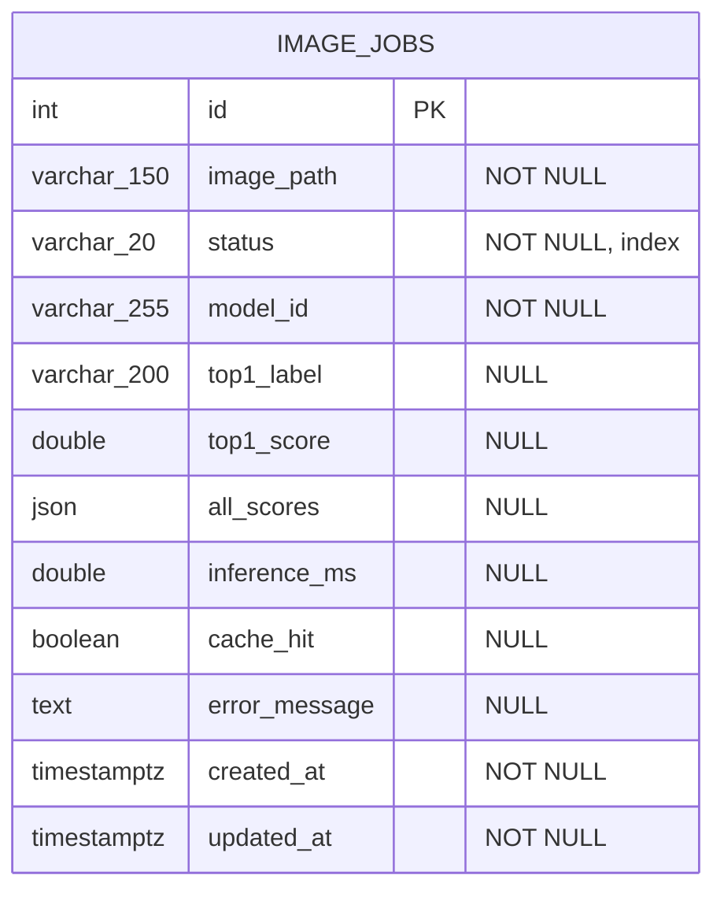
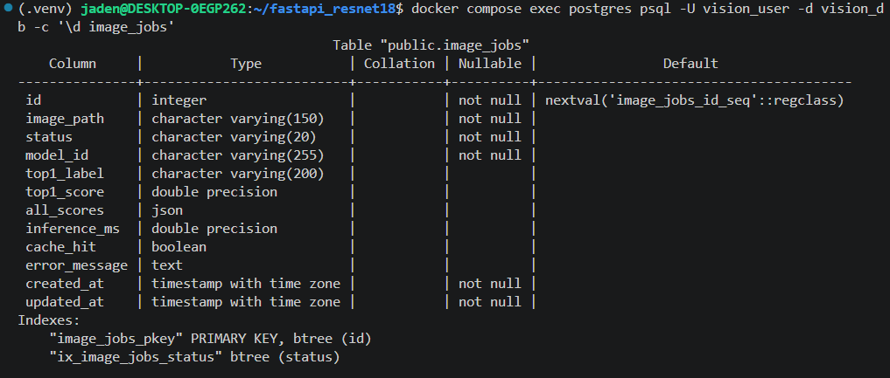
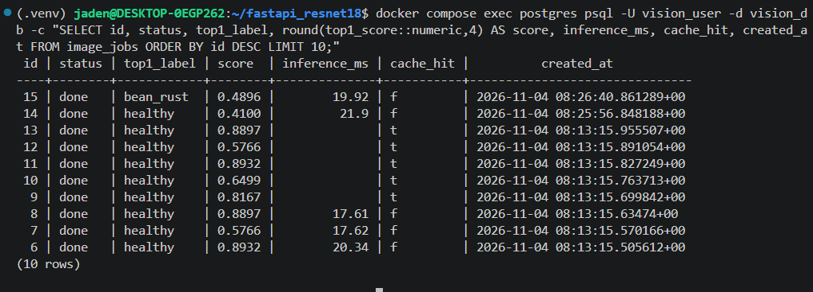
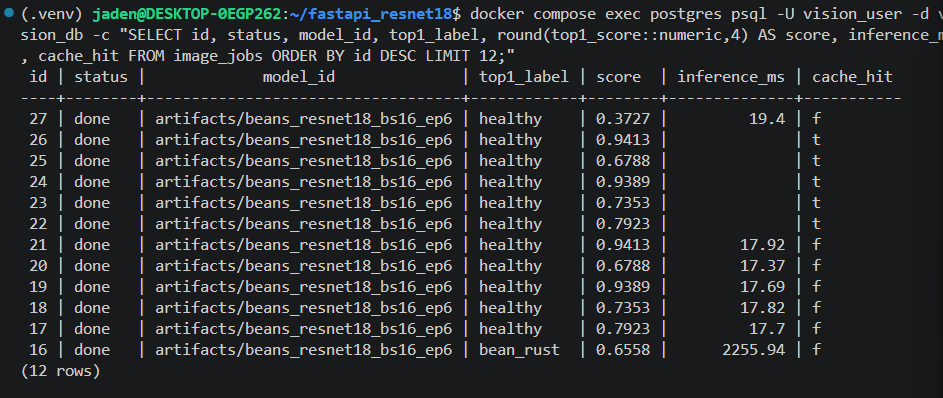

# 데이터베이스 구조 및 작업이력

- 테이블명: `image_jobs`
- PK: `id`
- 저장 대상: 비동기 추론의 작업 상태와 결과
- DB: PostgreSQL 17 (`postgres:17-alpine`, DB `vision_db`, 사용자 `vision_user`)
- 테이블 생성: FastAPI 시작 시 `init_db()`의 `Base.metadata.create_all()` (`main.py`, `ai/database.py`)
- 근거
  - 코드: `ai/models.py`
  - 실제 스키마와 행: `reports/evidence/raw/D01~D06_*.txt` (2026-11-04 17:32, 조회만 실행)

## 1. ERD



- DB에 있는 테이블은 `image_jobs` 1개뿐이다 (`\dt` 결과). FK와 관계 테이블은 없다.

## 2. 컬럼 정의

| 컬럼 | 실제 DB 자료형 | Nullable | 기본값 (설정 위치) | 실제 예시 값 (job 3) | 사용 이유 |
|---|---|---|---|---|---|
| id | integer | NOT NULL, PK | `nextval('image_jobs_id_seq')` (DB) | 3 | 고유 작업번호 |
| image_path | character varying(150) | NOT NULL | 없음 | `1e4a0e603e4e46a9a4140915fbc2fa74.bin` | `media/jobs/` 안의 파일 이름 |
| status | character varying(20) | NOT NULL, 인덱스 `ix_image_jobs_status` | `queued` (Python ORM) | `done` | 처리 상태 |
| model_id | character varying(255) | NOT NULL | `""` (Python ORM). 등록 시 `MODEL_PATH`를 넣음 | `artifacts/beans_resnet18` | 사용 모델 식별 |
| top1_label | character varying(200) | NULL | 없음 | `bean_rust` | 최종 분류 라벨 |
| top1_score | double precision | NULL | 없음 | 0.5147 | 분류 점수 |
| all_scores | json | NULL | 없음 | `[{"label": "bean_rust", "score": 0.5147…}, …]` | 전체 클래스 점수 |
| inference_ms | double precision | NULL | 없음 | 2215.86 | 모델 추론 시간 (캐시 HIT이면 NULL) |
| cache_hit | boolean | NULL | 없음 | false | Redis 캐시 재사용 여부 |
| error_message | text | NULL | 없음 | NULL | 실패 원인 (최대 1500자로 잘라 저장) |
| created_at | timestamp with time zone | NOT NULL | UTC 현재시각 (Python ORM) | 2026-11-04 08:13:01.419541+00 | 생성 시점 |
| updated_at | timestamp with time zone | NOT NULL | UTC 현재시각, 수정 시 갱신 (Python ORM `onupdate`) | 2026-11-04 08:13:03.731047+00 | 마지막 갱신 시점 |

- `status`, `model_id`, `created_at`, `updated_at`의 기본값은 DB에 설정되어 있지 않다 (`\d image_jobs`의 Default 칸이 비어 있음).
  - 이 기본값들은 SQLAlchemy가 INSERT할 때 Python 코드에서 값을 넣는다.
  - 그래서 psql로 직접 INSERT하면 이 기본값이 적용되지 않는다.
- 시각은 UTC로 저장된다 (`+00`). 한국 시각은 9시간을 더한다 (08:13 UTC = 17:13 KST).
- API 응답 필드와 DB 컬럼의 대응
  - `top1` = `top1_label` + `top1_score`
  - `all` = `all_scores`

## 3. SQL 조회

조회 명령 (모두 SELECT 또는 `\d`만 실행했다. INSERT, UPDATE, DELETE는 하지 않았다)

```bash
docker compose exec postgres psql -U vision_user -d vision_db -c '\d image_jobs'
docker compose exec postgres psql -U vision_user -d vision_db -c "SELECT id, status, model_id, top1_label, round(top1_score::numeric,4) AS top1_score, inference_ms, cache_hit, image_path, created_at, updated_at, error_message FROM image_jobs ORDER BY id;"
docker compose exec postgres psql -U vision_user -d vision_db -c "SELECT status, count(*) FROM image_jobs GROUP BY status ORDER BY status;"
```

조회 결과 (2026-11-04 17:32 KST, 전체 15행)

| id | status | top1_label | top1_score | inference_ms | cache_hit | created_at (KST) | 판정 |
|---:|---|---|---:|---:|---|---|---|
| 1 | done | bean_rust | 0.9678 | 2936.72 | false | 14:39:17 | 이전 실습 작업 (아래 참고) |
| 2 | done | bean_rust | 1.0000 | 69.7 | false | 15:39:33 | 이전 실습 작업 (아래 참고) |
| 3 | done | bean_rust | 0.5147 | 2215.86 | false | 17:13:01 | 비동기 추론 완료. Worker 첫 작업 (모델 로드 포함) |
| 4~8 | done | healthy | 0.5766~0.8932 | 17.04~20.34 | false | 17:13:15 | 비동기 추론 완료 (성능 측정 A-MISS 1~5) |
| 9~13 | done | healthy | 4~8과 같은 값 | NULL | true | 17:13:15 | 캐시 결과 재사용 (성능 측정 A-HIT 1~5) |
| 14 | done | healthy | 0.4100 | 21.9 | false | 17:25:56 | 브라우저 비동기 화면 (`bean_rust_test.3.jpg`, 오분류) |
| 15 | done | bean_rust | 0.4896 | 19.92 | false | 17:26:40 | 브라우저 비동기 화면 |

상태별 개수

| status | count |
|---|---:|
| done | 15 |

- `failed` 행: **미발생**. 이번 확인 범위에서 실패한 작업은 없었다.
- 실패 처리 방식 (코드 기준, 실행으로는 확인하지 않음)
  - Worker 처리 중 예외: `status=failed`, `error_message`에 `예외이름: 내용` 저장
  - 큐 등록 실패: `status=failed`, `error_message`에 `작업 큐 등록 실패: Redis 연결을 확인하세요.` 저장
- job 9~13의 `top1_score`는 같은 이미지를 처리한 job 4~8과 같다.
  - `inference_ms`가 NULL이고 `cache_hit`가 true이다.
  - Worker가 모델을 실행하지 않고 Redis 캐시 결과를 그대로 저장했다는 뜻이다.

job 1, 2에 대한 참고
- 두 작업의 업로드 파일은 소유자가 `root`이다.
- 셸 기록에 `docker compose up -d --build`가 있다. 그래서 그때 실행한 web·worker 컨테이너가 처리한 작업으로 보인다.
- 생성 시각(14:39, 15:39 KST)이 현재 Head-only 모델의 저장 시각(15:48, 이후 17:02)보다 앞선다. 그래서 다른 시점의 모델로 처리된 결과이다.
- 그런데도 `model_id`는 `artifacts/beans_resnet18`로 같다.
- 한계: `model_id`는 모델 경로만 기록한다. 같은 경로의 모델 파일이 바뀌어도 DB에서는 구분할 수 없다.

## 4. 상태 전이

```
queued ──(Worker가 작업 받음)──> running ──(추론·저장 성공)──> done
                                          └─(예외 발생)────────> failed
(큐 등록 실패 시: queued → failed, API는 503 응답)
```

| 단계 | 변경 주체 | 코드 |
|---|---|---|
| 행 생성, `queued` | FastAPI (API-03) | `router_async.py`: `ImageJob(image_path=filename, status="queued", model_id=MODEL_PATH)` |
| `running` | Celery Worker | `tasks.py`: `job.status = "running"` 후 commit |
| `done` | Celery Worker | `tasks.py`: 결과 컬럼을 채우고 `status = "done"` |
| `failed` | Worker 또는 FastAPI | `tasks.py` except 블록, `router_async.py` 큐 등록 실패 처리 |

- 이미 `done`인 작업을 다시 받으면 Worker는 처리하지 않고 그대로 반환한다 (`tasks.py`).

job 3의 실제 전이 기록 (API-04를 약 0.1초 간격으로 조회한 결과와 DB 시각)

| 시각 (KST) | 상태 | 근거 |
|---|---|---|
| 17:13:01.4195 | 행 생성 (`queued`) | DB `created_at` |
| 17:13:01.46 | `queued` 조회됨 | `raw/T04_async_poll.txt` |
| 17:13:03.73 | `running` 조회됨 | `raw/T04_async_poll.txt` |
| 17:13:03.7310 | `done` 저장 | DB `updated_at` |
| 17:13:03.86 | `done` 조회됨 | `raw/T04_async_poll.txt` |

- `created_at`부터 `updated_at`까지 2.31초 걸렸다 (`raw/D05_job3_allscores.txt`의 elapsed `00:00:02.311506`).
- 대부분은 Worker 프로세스가 모델을 처음 로드한 시간이다.
- 모델이 이미 로드된 job 14는 0.037초 걸렸다.

## 5. 이미지 저장 위치

- 실제 저장 위치: `media/jobs/<uuid>.bin`
  - DB에는 이미지 바이너리를 저장하지 않는다. 파일 이름만 `image_path`에 저장한다.
  - 사용자가 보낸 파일 이름은 쓰지 않는다. `uuid4().hex` + `.bin`을 쓴다.
- 확인 결과
  - `media/jobs/`의 파일 수: 15개. DB 행 수 15개와 같다.
  - job 1, 3, 14의 `image_path` 파일이 모두 있다. 형식은 JPEG image data이다.
  - job 3의 파일 `1e4a0e603e4e46a9a4140915fbc2fa74.bin`과 업로드한 원본 `dataset/test/bean_rust/bean_rust_test.1.jpg`의 SHA-256이 같다: `85c10070…95437f7`
  - 업로드한 바이트가 그대로 저장되었다.

## 6. 동기 요청의 DB 행 생성

- 기본 제공 코드에서는 생성하지 않는다. `router_sync.py`에는 DB 쓰기 코드가 없다.
- 실행으로도 확인했다 (2026-11-04 17:12~17:13).
  - 동기 요청: 웜업 1 + 클래스별 3 + 캐시 확인 2 + 성능 측정 10 = 16회
  - 비동기 요청: T-03 1 + 성능 측정 10 = 11회
  - 이 시간대에 생긴 행은 id 3~13, 11개이다. 비동기 요청 수와 같고, 동기 요청으로 생긴 행은 없다.

## 7. 증빙

| 항목 | 파일 |
|---|---|
| 테이블 구조 | `raw/D01_schema.txt`, `raw/D02_columns.txt`, `raw/D06_tables.txt` |
| 전체 행 | `raw/D03_rows.txt` |
| 상태별 개수 | `raw/D04_status_count.txt` |
| job 3, 14 상세 (all_scores, 처리 시간) | `raw/D05_job3_allscores.txt` |
| 상태 조회 기록 | `raw/T04_async_poll.txt` |
| 테스트 직후 조회 (최근 10행) | `raw/T06_db_image_jobs.txt` |
| 테이블 구조 캡처 | [evidence/db_schema.png](evidence/db_schema.png) |
| 행 조회 캡처 (최근 10행) | [evidence/db_rows.png](evidence/db_rows.png) |





- 위 `raw/` 경로의 위치: `reports/evidence/raw/`

## 8. 최종 모델 교체 후 기록 (2026-11-04 18:32)

- 서비스 모델을 `artifacts/beans_resnet18_bs16_ep6`로 교체한 뒤(18:31) 같은 테스트를 다시 실행했다.
- 테이블 구조는 그대로이다. 마이그레이션이나 데이터 삭제는 하지 않았다.

조회 결과 (id 16 이상, `raw_bs16_ep6/T06_db_image_jobs.txt`)

| id | status | model_id | top1_label | top1_score | inference_ms | cache_hit | 처리 시간 (updated−created) | 판정 |
|---:|---|---|---|---:|---:|---|---:|---|
| 16 | done | artifacts/beans_resnet18_bs16_ep6 | bean_rust | 0.6558 | 2255.94 | false | 2.3115초 | Worker 첫 작업 (모델 로드 포함), 정답 |
| 17~21 | done | artifacts/beans_resnet18_bs16_ep6 | healthy | 0.6788~0.9413 | 17.37~17.92 | false | 0.0286~0.0294초 | 비동기 추론 완료 (성능 측정 A-MISS) |
| 22~26 | done | artifacts/beans_resnet18_bs16_ep6 | healthy | 17~21과 같은 값 | NULL | true | 0.0085~0.0116초 | 캐시 결과 재사용 (A-HIT) |

모델별·상태별 개수

| model_id | status | count |
|---|---|---:|
| artifacts/beans_resnet18 | done | 15 |
| artifacts/beans_resnet18_bs16_ep6 | done | 11 |

- 이번에는 `model_id`로 교체 전후 작업이 구분된다. 모델 경로(폴더 이름)를 바꿨기 때문이다.
  - 3장에서 적은 한계(같은 경로의 파일이 바뀌면 구분 불가)는 그대로 남아 있다.
- `failed` 행: 교체 후에도 미발생
- 동기 요청은 교체 후에도 행을 만들지 않았다. 동기 16회, 비동기 11회를 보냈고, 새 행은 11개(id 16~26)이다.
- `media/jobs/` 파일 수: 26개. DB 행 수 26개와 같다.
- 행 조회 캡처 (18:40, 최근 12행): 위 표의 id 16~26과 브라우저 비동기 화면에서 만든 id 27(healthy 0.3727, 19.4ms)이 보인다.


