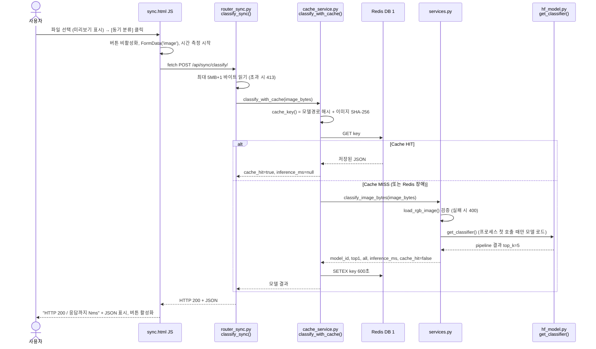
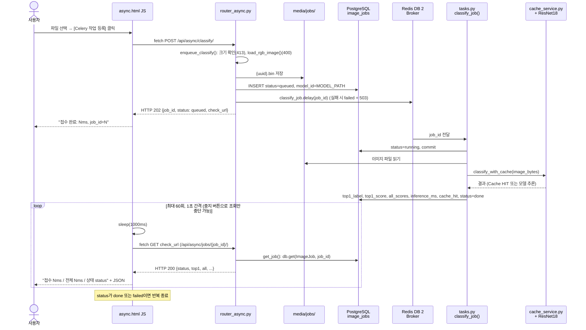
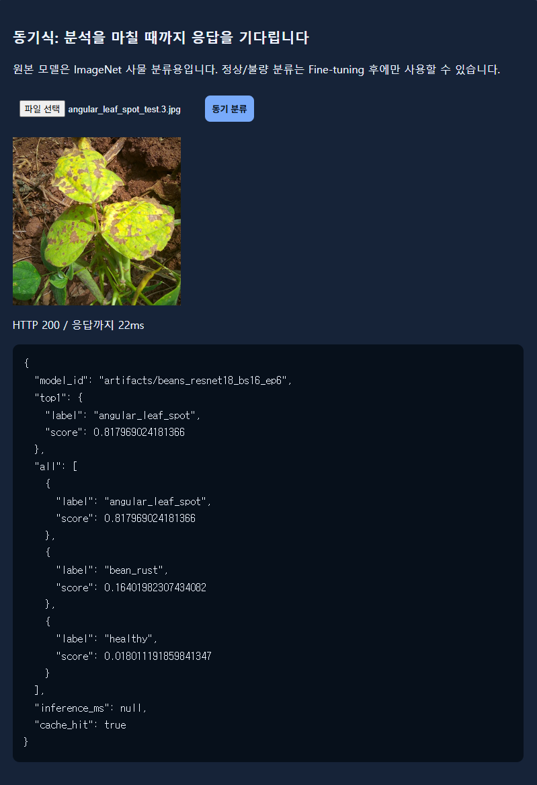
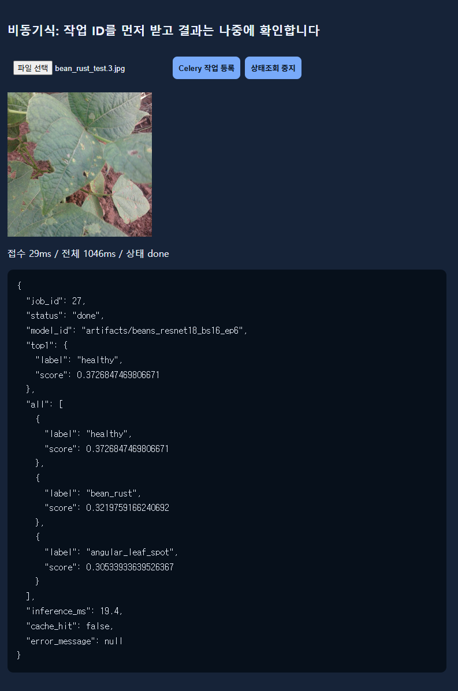

# AI 분석 버튼 처리 파이프라인

- 대상 화면
  - 동기: `/vision/sync/`의 **[동기 분류]** 버튼
  - 비동기: `/vision/async/`의 **[Celery 작업 등록]** 버튼
- 근거
  - 코드: `templates/sync.html`, `templates/async.html`, `ai/*.py`
  - 실행 기록: `reports/evidence/` (2026-11-04 17:12~17:27)

## A. 동기 버튼 클릭 시퀀스

## B. 비동기 버튼 클릭 시퀀스

- Worker 처리 중 예외가 나면 `tasks.py`가 rollback한 뒤 `status=failed`와 `error_message`를 저장한다.
- **[상태조회 중지]** 버튼은 브라우저의 조회 반복만 멈춘다. Worker 작업은 계속된다 (`async.html` 안내 문구).

## C. 실제 코드 연결표

| 단계 | 시작 파일 | 핵심 함수·처리 | 반환 / 다음 단계 |
|---|---|---|---|
| 동기 1 | `templates/sync.html` | 버튼 `onclick` → `FormData.append('image', file)` → `fetch('/api/sync/classify/', {method:'POST'})` | `POST /api/sync/classify/` |
| 동기 2 | `ai/router_sync.py` | `classify_sync(image)`: `image.file.read(MAX_UPLOAD_BYTES + 1)`, 5MB 초과 시 413 | `classify_with_cache(image_bytes)` |
| 동기 3 | `ai/cache_service.py` | `classify_with_cache()`: `cache_key()`, `get_redis().get(key)` | HIT: 저장 결과 반환 / MISS: `classify_image_bytes()` 다음 `setex(key, 600, …)` |
| 동기 4 | `ai/services.py` | `classify_image_bytes()`: `load_rgb_image()` 검증(400), `get_classifier()(image, top_k=5)`, 점수 정렬 | `model_id`, `top1`, `all`, `inference_ms`, `cache_hit` |
| 동기 5 | `ai/hf_model.py` | `get_classifier()`: `@lru_cache(maxsize=1)`, `pipeline("image-classification", model=MODEL_PATH, device=-1)` | 프로세스마다 1회 로드한 CPU 모델 |
| 동기 6 | `templates/sync.html` | `res.json()` → `state`, `output` 표시 | 화면 출력 |
| 비동기 1 | `templates/async.html` | 버튼 `onclick` → `fetch('/api/async/classify/', {method:'POST'})` | `POST /api/async/classify/` |
| 비동기 2 | `ai/router_async.py` | `enqueue_classify()`: 크기·이미지 검증 → `media/jobs/{uuid4().hex}.bin` 저장 → `ImageJob(status="queued")` commit → `classify_job.delay(job_id)` | HTTP 202 `{job_id, status, check_url}` |
| 비동기 3 | `ai/celery_app.py` | `Celery("vision_ai", broker=…/2, backend=…/3, include=["ai.tasks"])` | Worker에 작업 전달 |
| 비동기 4 | `ai/tasks.py` | `classify_job(job_id)`: `running` commit → 파일 읽기 → `classify_with_cache()` → 결과 컬럼 저장, `done` (예외 시 `failed`) | DB 갱신 |
| 비동기 5 | `templates/async.html` | `for (i<60)`: `sleep(1000)` → `fetch(data.check_url)` | `GET /api/async/jobs/{job_id}/` |
| 비동기 6 | `ai/router_async.py` | `get_job(job_id)`: 없으면 404. `done`일 때만 `top1`, `all` 채움 | 상태와 결과 JSON |

- 동기와 비동기는 **같은 함수** `classify_with_cache()` → `classify_image_bytes()` → `get_classifier()`를 거친다.
- 차이는 이 함수들을 부르는 프로세스이다.
  - 동기: FastAPI 프로세스
  - 비동기: Celery Worker 프로세스

## D. 실제 실행 예시

| 구분 | 입력 | 결과 | 시간 | 근거 |
|---|---|---|---|---|
| 동기, 화면 | `angular_leaf_spot_test.3.jpg` | 200, angular_leaf_spot 0.5927, `cache_hit` false | 화면 "응답까지 45ms", `inference_ms` 20.99 | [sync_page.png](evidence/sync_page.png) |
| 동기, 프로세스 첫 요청 | `angular_leaf_spot_test.1.jpg` | 200, angular_leaf_spot 0.5182 | `inference_ms` 2253.55 (모델 로드 포함) | `raw/W01_warmup_sync.txt` |
| 동기, 캐시 HIT | `bean_rust_test.0.jpg` 재요청 | 200, `cache_hit` true, `inference_ms` null | 약 1.8ms | `raw/T09_cache_2nd.txt` |
| 비동기, Worker 첫 작업 | `bean_rust_test.1.jpg` → job 3 | 202 → running → done, bean_rust 0.5147 | 접수 31.6ms, DB 생성~완료 2.31초, Worker 로그 `succeeded in 2.29s` | `raw/T03_async_post.txt`, `raw/T04_async_poll.txt`, [worker_log.png](evidence/worker_log.png) |
| 비동기, 화면 | `bean_rust_test.3.jpg` → job 14 | done, healthy 0.4100 (오분류) | 화면 "접수 29ms / 전체 1043ms", DB 생성~완료 0.037초 | [async_page.png](evidence/async_page.png), `raw/D05_job3_allscores.txt` |

- job 14는 Worker가 0.037초 만에 끝냈다. 그런데 화면에는 "전체 1043ms"로 표시됐다.
  - 이유: `async.html`이 첫 조회 전에 `sleep(1000)`으로 1초를 기다린다.
  - 그래서 비동기 화면의 전체 시간은 최소 1초 이상이고, 실제 처리 시간이 아니라 조회 간격에 맞춰 표시된다.
- 성능 측정(`reports/data/timings.csv`, 각 5회 평균)
  - 동기 MISS 응답 22.30ms, 동기 HIT 1.93ms
  - 비동기 등록 응답 8.37ms
  - 비동기 완료 확인까지 64.69ms (스크립트 50ms 간격 조회 기준)
- 위 `raw/` 경로의 위치: `reports/evidence/raw/`

## E. 비교 결론

| 항목 | 동기 | 비동기 |
|---|---|---|
| 첫 응답 내용 | 분류 결과 (200) | 작업 접수 (202 + `job_id`) |
| 결과 확인 | 첫 응답에 포함 | `check_url`을 반복 조회해야 함 |
| 추론 실행 프로세스 | FastAPI | Celery Worker |
| DB 기록 | 없음 | `image_jobs`에 상태·결과 저장 |
| 이미지 파일 보관 | 없음 (메모리에서만 처리) | `media/jobs/{uuid}.bin` |
| 화면 대기 | 추론이 끝날 때까지 버튼 비활성화 | 접수 후 1초 간격 조회 (최대 60회) |
| 사용 모델과 캐시 | 같은 ResNet18 (`MODEL_PATH`의 모델, 현재 `artifacts/beans_resnet18_bs16_ep6`), 같은 Redis 캐시 키 | 같음 |

- 분류 결과를 만드는 모델과 함수는 같다. 결과를 전달하는 방법만 다르다.
- 이 모델은 한 장 추론이 약 17~21ms로 짧다. 그래서 이번 측정에서는 동기 방식이 결과를 더 빨리 보여준다.
- 비동기 방식은 요청 처리와 추론을 다른 프로세스로 나눈다. 대신 등록, 큐 전달, DB 기록, 조회 단계가 추가된다.

## F. 증빙

| 항목 | 파일 |
|---|---|
| 동기 화면 | [evidence/sync_page.png](evidence/sync_page.png) |
| 비동기 화면 | [evidence/async_page.png](evidence/async_page.png) |
| Celery Worker 로그 | [evidence/worker_log.png](evidence/worker_log.png) |
| FastAPI 접근 로그 | [evidence/uvicorn_log.png](evidence/uvicorn_log.png) |
| 응답 원본 | `evidence/raw/W01_*`, `T02_*`, `T03_*`, `T04_*`, `T09_*` |

## G. 최종 모델 교체 후 실행 예시 (2026-11-04 18:31~18:32)

서비스 모델을 `artifacts/beans_resnet18_bs16_ep6`로 바꿨다. A~C의 처리 흐름과 코드 경로는 그대로이며, 바뀐 것은 `.env`의 `MODEL_PATH`뿐이다.

| 구분 | 입력 | 결과 | 시간 | 근거 (`evidence/raw_bs16_ep6/`) |
|---|---|---|---|---|
| 동기, 프로세스 첫 요청 | `angular_leaf_spot_test.1.jpg` | 200, angular_leaf_spot 0.7372 | `inference_ms` 2125.23 (모델 로드 포함) | `W01_warmup_sync.txt` |
| 동기, 캐시 MISS | `bean_rust_test.0.jpg` | 200, bean_rust 0.7914, `cache_hit` false | `inference_ms` 16.79, 응답 21.1ms | `T02_sync_bean_rust.txt` |
| 동기, 캐시 HIT | 같은 이미지 재요청 | 200, `cache_hit` true, `inference_ms` null | 약 1.6~2.0ms | `T09_cache_*.txt` |
| 비동기, Worker 첫 작업 | `bean_rust_test.1.jpg` → job 16 | 202 → running → done, bean_rust 0.6558 | 접수 29.5ms, DB 생성~완료 2.31초 | `T03_async_post.txt`, `T04_async_poll.txt` |
| 비동기, 이후 작업 | `healthy_test.1~5.jpg` → job 17~21 | done, 모두 healthy | DB 생성~완료 약 29ms | `T06_db_image_jobs.txt` |

- 화면 확인
  - 동기: [sync_page_bs16_ep6.png](evidence/sync_page_bs16_ep6.png) (18:36): `angular_leaf_spot_test.3.jpg` → angular_leaf_spot 0.8180, 화면 응답 22ms, 600초 안의 재요청이라 `cache_hit: true`
  - 비동기: [async_page_bs16_ep6.png](evidence/async_page_bs16_ep6.png) (18:37): `bean_rust_test.3.jpg` → job 27, healthy 0.3727 (오분류, 기준선 A에서도 healthy로 오분류된 이미지), 화면 표시 접수 29ms / 전체 1046ms. 전체 시간 1046ms는 `async.html`의 1초 조회 간격 때문이다.
- 최종 모델 실행 중 Worker·Uvicorn 로그 캡처는 따로 찍지 않았다. 같은 코드의 로그 예시로 기준선 A 실행 때의 [worker_log.png](evidence/worker_log.png), [uvicorn_log.png](evidence/uvicorn_log.png)를 참고한다. 최종 모델의 동작 근거는 `evidence/raw_bs16_ep6/`의 상태코드·`model_id` 원본 응답과 DB 시각(`T06_db_image_jobs.txt`), [db_rows_bs16_ep6.png](evidence/db_rows_bs16_ep6.png)이다.

- 성능 측정 중앙값: 동기 MISS 21.81ms, 동기 HIT 1.48ms, 비동기 접수 8.45ms, 비동기 최종 확인 63.91ms (산출물 6)
- E장의 비교 결론은 교체 후에도 같다. 모델 구조가 같아 추론 시간도 거의 같다 (동기 16.42ms, 비동기 17.70ms).
