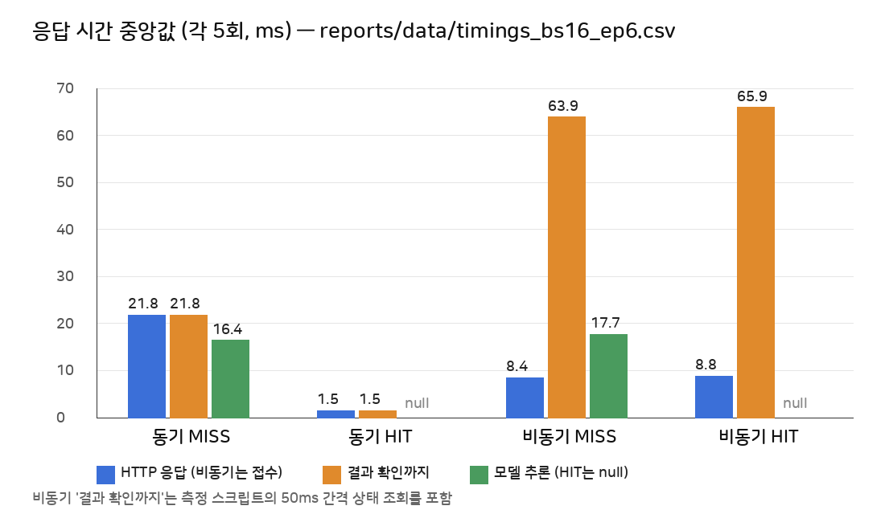

# 성능 측정 및 비교 보고서

- 원본 데이터 (측정 후 수정하지 않음)
  - 최종 모델: `reports/data/timings_bs16_ep6.csv` (20행)
  - 기준선 A 모델: `reports/data/timings.csv` (20행, 비교용)
- 그래프: `reports/figures/timings_compare_bs16_ep6.png` (최종), `reports/figures/timings_compare.png` (기준선 A)
- 측정 일시: 최종 모델 2026-11-04 18:32 KST, 기준선 A 17:13 KST
- 측정 도구: `.venv`의 Python `httpx` 스크립트, 같은 PC에서 `127.0.0.1:8000`으로 요청
- 모든 시간 단위: ms

## 1. 실험 조건

| 조건 | 값 |
|---|---|
| 모델 | 최종: `artifacts/beans_resnet18_bs16_ep6` (Head-only, batch 16, epoch 6, SHA-256 `fce87a91…a4d7ba`) / 비교: `artifacts/beans_resnet18` (기준선 A, batch 8, epoch 3, SHA-256 `c4ba88e1…7d710e`) |
| 모델 구조 | 두 모델 모두 ResNet-18, 입력 224, 출력 3클래스. 학습 설정만 다름 |
| 추론 장치 | CPU (`ai/hf_model.py`의 `device=-1`). GPU는 서비스 추론에 사용하지 않음 |
| 실행환경 | Windows 11 Pro + WSL2 Ubuntu 26.04.1 LTS, Intel Core i7-12700 (WSL 논리 CPU 20개), WSL 메모리 15GiB, GPU RTX 3060 12GB (미사용) |
| 서버 | Uvicorn 1 프로세스 (`--host 127.0.0.1 --port 8000`, `--reload` 없음) |
| Worker | Celery `--pool=solo --concurrency=1` |
| Redis / DB | Docker `redis:7.4-alpine`, `postgres:17-alpine` |
| 반복 | 조건별 5회 (동기 MISS, 동기 HIT, 비동기 MISS, 비동기 HIT) |
| 워밍업 | 측정 전에 FastAPI와 Worker 모두 첫 요청을 끝냄. 비교에서 제외하고 따로 기록 (3장) |
| 캐시 | Redis를 비우지 않음. 캐시 키에 `MODEL_PATH`가 들어가므로 모델을 바꾸면 같은 이미지도 MISS가 됨. HIT는 직전 MISS와 같은 이미지를 다시 보냄. 실제 `cache_hit` 값으로 확인 |
| 비동기 완료 시간 | 측정 스크립트가 POST 직후부터 **50ms 간격**으로 상태를 조회해 `done`을 처음 본 시각까지 측정. 브라우저 화면(`async.html`)은 **1000ms 간격** |

측정 이미지 (두 모델 모두 같은 10장, MISS와 HIT는 같은 5장)

| 경로 | 이미지 | 크기 (B) | SHA-256 앞 16자 |
|---|---|---:|---|
| 동기 | `angular_leaf_spot/angular_leaf_spot_test.2.jpg` | 152,508 | 3ca1bfe8e29bacea |
| 동기 | `angular_leaf_spot/angular_leaf_spot_test.3.jpg` | 163,694 | 84d6bc132e11f142 |
| 동기 | `angular_leaf_spot/angular_leaf_spot_test.4.jpg` | 121,452 | 8aac55976e458ef9 |
| 동기 | `angular_leaf_spot/angular_leaf_spot_test.5.jpg` | 119,978 | 78935bb91b82040a |
| 동기 | `angular_leaf_spot/angular_leaf_spot_test.6.jpg` | 161,546 | a1d2d621ba84b293 |
| 비동기 | `healthy/healthy_test.1.jpg` | 153,847 | 8650ef0b6849210c |
| 비동기 | `healthy/healthy_test.2.jpg` | 160,714 | e2c63864fc2f02bd |
| 비동기 | `healthy/healthy_test.3.jpg` | 145,450 | 2c94ac6b90db0b4e |
| 비동기 | `healthy/healthy_test.4.jpg` | 123,027 | ea4957e63f1fd4a9 |
| 비동기 | `healthy/healthy_test.5.jpg` | 113,318 | e926e0e5877fe376 |

- 동기와 비동기에 서로 다른 이미지를 썼다. 같은 이미지를 쓰면 두 번째 경로가 캐시 HIT가 되기 때문이다. 파일 크기는 113~164KB로 비슷하다.

## 2. 원본 측정표 (최종 모델)

### 2.1 동기

| 반복 | MISS HTTP·전체 | MISS 추론 | HIT HTTP·전체 | HIT 추론 |
|---:|---:|---:|---:|---:|
| 1 | 24.63 | 18.54 | 2.01 | null |
| 2 | 22.56 | 16.77 | 1.49 | null |
| 3 | 21.81 | 16.24 | 1.48 | null |
| 4 | 21.30 | 16.42 | 1.45 | null |
| 5 | 19.63 | 14.57 | 1.45 | null |
| **중앙값** | **21.81** | **16.42** | **1.48** | — |
| 평균 | 21.99 | 16.51 | 1.58 | — |

- 동기는 HTTP 응답에 결과가 들어 있다. 그래서 HTTP 시간과 전체 시간이 같다 (`http_ms` = `final_ms`).

### 2.2 비동기

| 반복 | job | MISS 접수 HTTP | MISS 최종 확인 | MISS 추론 | job | HIT 접수 HTTP | HIT 최종 확인 | HIT 추론 |
|---:|---:|---:|---:|---:|---:|---:|---:|---:|
| 1 | 17 | 8.87 | 64.14 | 17.70 | 22 | 8.08 | 65.52 | null |
| 2 | 18 | 8.78 | 64.50 | 17.82 | 23 | 9.28 | 66.06 | null |
| 3 | 19 | 8.45 | 63.89 | 17.69 | 24 | 11.88 | 69.56 | null |
| 4 | 20 | 7.81 | 63.91 | 17.37 | 25 | 8.83 | 65.89 | null |
| 5 | 21 | 7.02 | 62.57 | 17.92 | 26 | 7.78 | 65.94 | null |
| **중앙값** | | **8.45** | **63.91** | **17.70** | | **8.83** | **65.94** | — |
| 평균 | | 8.19 | 63.80 | 17.70 | | 9.17 | 66.59 | — |

### 2.3 보조 지표: DB 기준 비동기 처리 시간

`image_jobs`의 `updated_at - created_at`이다. 행 생성부터 Worker가 `done`을 저장할 때까지이며, 큐 대기를 포함한다 (`reports/evidence/raw_bs16_ep6/T06_db_image_jobs.txt`의 `elapsed`).

| 반복 | MISS job | MISS 처리 | HIT job | HIT 처리 |
|---:|---:|---:|---:|---:|
| 1 | 17 | 29.35 | 22 | 8.62 |
| 2 | 18 | 29.13 | 23 | 8.45 |
| 3 | 19 | 28.97 | 24 | 11.57 |
| 4 | 20 | 28.60 | 25 | 9.31 |
| 5 | 21 | 29.37 | 26 | 8.94 |
| **중앙값** | | **29.13** | | **8.94** |
| 평균 | | 29.09 | | 9.38 |

## 3. 워밍업 (비교에서 제외)

| 프로세스 | 요청 | inference_ms | 근거 |
|---|---|---:|---|
| FastAPI | 동기 `angular_leaf_spot_test.1.jpg` | 2125.23 (HTTP 2155.70) | `raw_bs16_ep6/W01_warmup_sync.txt` |
| Celery Worker | 비동기 job 16 `bean_rust_test.1.jpg` | 2255.94 (DB 생성~완료 2.31초) | `raw_bs16_ep6/T04_async_final.txt`, `raw_bs16_ep6/T06_db_image_jobs.txt` |

- 프로세스마다 첫 요청에서 모델을 로드한다 (`@lru_cache`). 그래서 첫 요청이 약 2.1~2.3초로, 이후 요청(약 16~18ms)보다 100배 이상 느리다.
- 위 `raw_bs16_ep6/` 경로의 위치: `reports/evidence/raw_bs16_ep6/`

## 4. 계산 (최종 모델, 중앙값 기준, 평균 기준은 괄호)

```text
[MISS 대 MISS] HTTP 응답시간 감소율 (동기 결과 응답 → 비동기 접수 응답)
  = (21.81 - 8.45) / 21.81 × 100 = 61.26%      (평균: (21.99 - 8.19) / 21.99 × 100 = 62.76%)

[MISS 대 MISS] 결과 확인시간 차이 (비동기 최종 확인 - 동기 결과 응답)
  = 63.91 - 21.81 = 42.10 ms, 비동기가 더 느림  (평균: 63.80 - 21.99 = 41.81 ms)

[동기] 캐시 HIT 응답시간 감소율
  = (21.81 - 1.48) / 21.81 × 100 = 93.21%      (평균: (21.99 - 1.58) / 21.99 × 100 = 92.81%)

[비동기] 캐시 HIT 최종 확인시간 차이 (HIT - MISS)
  = 65.94 - 63.91 = +2.03 ms                   (평균: 66.59 - 63.80 = +2.79 ms)

[비동기, DB 기준] 캐시 HIT 처리시간 감소율
  = (29.13 - 8.94) / 29.13 × 100 = 69.31%      (평균: (29.09 - 9.38) / 29.09 × 100 = 67.76%)
```

## 5. 캐시 비교표 (최종 모델, 중앙값)

| 경로 | 캐시 | HTTP 응답 | 결과 확인까지 | 추론시간 | DB 기준 처리 | 메모 |
|---|---|---:|---:|---:|---:|---|
| 동기 | MISS | 21.81 | 21.81 | 16.42 | — | 모델 실제 추론 |
| 동기 | HIT | 1.48 | 1.48 | null | — | 모델 추론 생략 |
| 비동기 | MISS | 8.45 (접수) | 63.91 | 17.70 | 29.13 | 결과는 상태 조회로 확인 |
| 비동기 | HIT | 8.83 (접수) | 65.94 | null | 8.94 | Worker가 캐시 결과를 DB에 저장 |



### 5.1 모델별 비교 (같은 이미지·같은 조건, 중앙값)

| 항목 | 기준선 A (batch 8, epoch 3) | 최종 C (batch 16, epoch 6) | 차이 |
|---|---:|---:|---:|
| 동기 MISS HTTP | 21.54 | 21.81 | +0.27 |
| 동기 MISS 추론 | 16.39 | 16.42 | +0.03 |
| 동기 HIT HTTP | 1.74 | 1.48 | −0.26 |
| 비동기 MISS 접수 | 8.14 | 8.45 | +0.31 |
| 비동기 MISS 최종 확인 | 64.90 | 63.91 | −0.99 |
| 비동기 MISS 추론 | 17.62 | 17.70 | +0.08 |
| 비동기 HIT 최종 확인 | 64.02 | 65.94 | +1.92 |
| DB 기준 처리 MISS / HIT | 30.09 / 9.03 | 29.13 / 8.94 | −0.96 / −0.09 |
| 첫 요청 inference (FastAPI / Worker) | 2253.55 / 2215.86 | 2125.23 / 2255.94 | — |

- 두 모델은 구조와 파라미터 수가 같고 학습 설정만 다르다. 그래서 응답 시간 차이는 모두 1~2ms 이내로, 5회 측정의 흔들림 범위 안에 있다.
- 모델 교체로 응답 시간이 빨라지거나 느려졌다고 판단하지 않는다.

## 6. 해석

- 비동기 접수 HTTP 응답(8.45ms)은 동기 결과 응답(21.81ms)보다 61.26% 빨리 반환됐다.
  - 이 수치는 **모델 추론이 빨라졌다는 뜻이 아니다**.
  - 비동기 접수 응답에는 추론이 들어 있지 않다. 추론은 Worker에서 따로 실행되고, 시간은 17.70ms로 동기 16.42ms와 비슷하다.
- 결과를 확인하는 데까지는 비동기가 42.10ms 더 느렸다. 큐 전달, DB 기록, 상태 조회 단계가 추가되기 때문이다.
- 비동기 "결과 확인까지" 시간은 상태 조회 간격에 묶여 있다.
  - 측정 스크립트는 POST 직후 한 번 조회하고(아직 `queued`/`running`), 50ms 뒤 다시 조회해 `done`을 확인했다.
  - 그래서 MISS(63.91)와 HIT(65.94)가 거의 같고, 이번에는 HIT가 2.03ms 더 길게 나왔다. 실제 Worker 처리 시간은 29.13ms와 8.94ms로 달랐지만(DB 기준), 두 값 모두 50ms 조회 간격 안에 끝나서 측정값에 드러나지 않았다.
  - 브라우저 화면은 1000ms 간격으로 조회한다. 그래서 화면에서는 최소 1초 이상으로 보인다.
- 캐시 HIT의 `inference_ms = null`은 0ms라는 뜻이 아니다. 모델 추론을 **실행하지 않았다**는 뜻이다. 그래서 평균 계산에서 제외했다.
- 동기 경로에서는 캐시 효과가 HTTP 응답에 바로 드러난다 (93.21% 감소). 비동기 경로에서는 DB 기준 처리 시간에서만 드러난다 (69.31% 감소).
- 비교는 MISS 대 MISS, HIT 대 HIT로만 했다.

## 7. 모델 품질 지표 (응답 시간과 별개)

| 지표 | 기준선 A (batch 8, epoch 3) | 최종 C (batch 16, epoch 6) | 근거 |
|---|---:|---:|---|
| Best Validation Accuracy | 0.7669 | 0.8346 | 산출물 1, 각 모델 `training_report.json` |
| Test Accuracy | 0.7188 (92/128) | 0.8750 (112/128) | `reports/data/test_metrics_beans_resnet18*.json` |
| Test Macro F1 | 0.7109 | 0.8752 | 같음 |

- 위 값은 분류 정확도이고, 이 문서의 응답 시간과는 다른 지표다.
- 응답 시간은 두 모델이 거의 같지만 정확도는 다르다. 정확도 차이는 학습 설정(batch, epoch) 때문이며, 서빙 구조와는 관계없다.
- 같은 Test를 두 모델에 각각 1회 사용했다. 최종 모델의 Test 점수에는 낙관 편향이 있을 수 있다 (산출물 1의 3.3).
- 캐시와 비동기 구조는 정확도를 바꾸지 않는다. 같은 이미지는 동기와 비동기, MISS와 HIT에서 같은 점수가 나왔다 (예: `healthy_test.1.jpg` 0.7923, job 17과 job 22).
- 성능 측정 중 오분류: `angular_leaf_spot_test.4.jpg` → bean_rust 0.4729 (최종 모델). 기준선 A에서는 `angular_leaf_spot_test.5.jpg`가 오분류였고, 최종 모델에서는 정답(0.4893)이다.

## 8. 비교 조건 점검

- [x] 같은 모델 체크포인트로 측정 (최종: SHA-256 `fce87a91…`, 측정 중 변경 없음)
- [x] MISS 대 MISS, HIT 대 HIT 구분
- [x] 같은 하드웨어, 같은 서버·Worker 프로세스, 같은 시간대 (18:32)
- [x] 모델 비교(5.1)는 같은 이미지 10장, 같은 스크립트로 측정
- [ ] 동기와 비동기는 같은 이미지가 아님: 캐시 때문에 다른 이미지 사용. 크기는 비슷함 (113~164KB)
- [x] 모델 첫 로딩·warm-up 처리 여부 표기 (3장)
- [x] 반복 원본값과 요약표 일치 (`timings_bs16_ep6.csv`에서 계산)

한계
- 반복 수가 5회로 적다.
- 측정 클라이언트가 같은 PC에서 실행되어 네트워크 지연이 거의 없다.
- 동시 요청(부하)은 측정하지 않았다. Worker가 `concurrency=1`이라 동시 요청이 많으면 비동기 대기 시간이 길어질 수 있지만, 이번 측정 범위 밖이다.
- 비동기 최종 확인 시간은 50ms 조회 간격 단위로만 구분된다.
